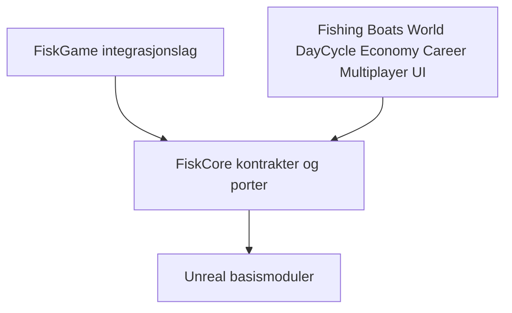

# FISKELAGET – Arkitektur

Status: arkitektur godkjent av prosjekteieren 3. november 2026. Kravspesifikasjon v1.0 er styrende; UE5 er valgt i masterprompten.

## Modulær monolitt

Ett UE-prosjekt `FiskELaget.uproject`, med to innledende runtime-moduler: `FiskCore` og `FiskGame`. Ikke én plugin per funksjon. En egen editor-modul opprettes bare ved faktisk behov for editorverktøy. Modulnavnet `FiskGame` er en fysisk pakking av de logiske funksjonene, ikke en tiende spillmodul.

| Logisk modul | Eier data og regler | Foreslått plassering |
|---|---|---|
| FiskCore | Sterke ID-er, delte verdiobjekter, kontrakter, tjenestegrensesnitt, versjoner | `Source/FiskCore/` |
| Fishing | Stangtilstand, napp, kroking, kamp og landing | `Source/FiskGame/Private/Fishing/` |
| Boats | Båt, kaptein, lager, transport, sleping og retur | `Source/FiskGame/Private/Boats/` |
| World | Habitat, dybde, kart, sjøpunkter og ekkolodd | `Source/FiskGame/Private/World/` |
| DayCycle | Felles klokke, faser, frist og dags-ID | `Source/FiskGame/Private/DayCycle/` |
| Economy | Priser, kjøp, salg, premier og hovedbok | `Source/FiskGame/Private/Economy/` |
| Career | Karriere, utstyr, journal, rekorder og varig profil | `Source/FiskGame/Private/Career/` |
| Multiplayer | LAN-økter, identitet, replisering, meldingsvalidering | `Source/FiskGame/Private/Multiplayer/` |
| UI | Menyer og lesemodeller for HUD, kart og marina | `Source/FiskGame/Private/UI/` |

FiskCore skal ikke kjenne konkrete funksjonsimplementasjoner eller UI-ressurser. Funksjonsområdene skal ikke inkludere hverandres private headere. Kun grensesnitt og verdiobjekter som faktisk deles plasseres i FiskCore. FiskGame sitt integrasjonslag setter sammen implementasjonene og ruter hendelser/kommandoer.

Pilene viser kompileringsavhengigheter. Funksjonsområdene har ingen direkte kompileringsavhengigheter til hverandre. UE-avhengigheter holdes minimale og listes eksplisitt i Build.cs ved opprettelse. En enkel grensekontroll i CI skal finne ulovlige includes; dette er en praktisk avgrensning, ikke et fullstendig språkbasert vern når områdene ligger i samme fysiske modul.

## Kommunikasjon og serverautoritet

Multiplayer oversetter en autentisert spillers forespørsel til en validert kommando hos eiermodulen. Eiermodulen godkjenner selv rettigheter og tilstand. Serveren eier spillutfallet; klienten viser repliserte lesemodeller. UI skriver aldri direkte i økonomi, båt eller profil.

World leverer habitat- og dybdeoppslag gjennom porter. Fishing publiserer landing; Boats avgjør lagring/transport; DayCycle avgjør tidsfrist; Economy godkjenner salg; Career materialiserer bekreftede endringer i varig profil. Ingen mottaker skal kunne endre avsenderens interne objekter.

I første prototype kjøres autoritative spilloverganger sekvensielt i serverens simulasjonskontekst. Tunge IO-jobber skal ikke endre spilltilstand fra egne tråder. Dokumentert rekkefølge og oppgjørsbarriere sikrer at salg ikke blir avhengig av tilfeldig leveringsrekkefølge mellom `BoatArrived` og `DayDeadlineReached`.

## Oppgjør og eierskap

Boats eier lagerposter. Fishing eier kampframdrift, men ingen salgsrett. Economy eier transaksjoner; Career eier den lagrede projeksjonen, ikke en ekstra uavhengig pengesaldo som kan godkjenne kjøp. Salg bruker serverbekreftet fangst-ID, båtankomst, dags-ID og oppgjørsstatus. Unik transaksjonsnøkkel hindrer dobbel utbetaling; transaksjon og utgående bekreftelse må kunne gjenopptas etter krasj.

Fristen er absolutt ved minutt 17. Eksakt registrering av grenseankomst og marinasone er en åpen designavklaring fra kravspesifikasjonen og skal godkjennes før implementasjon. Ingen tidsbuffer eller «nesten framme»-unntak innføres.

Skjult art, eksakt vekt og utholdenhet skal ikke eksponeres til klientens HUD før godkjent tidspunkt. En full serverhendelse er derfor ikke en offentlig nettverkspakke.

## Innhold og mulig videre oppdeling

Bruk `Content/FiskELaget/<Modul>/` for ressurseierskap. Felles kart og binære ressurser redigeres av én agent om gangen. Splitt logiske områder til flere fysiske UE-moduler først når avhengigheter, byggetid eller teamarbeid viser et konkret behov, og registrer endringen i DECISIONS.md.
