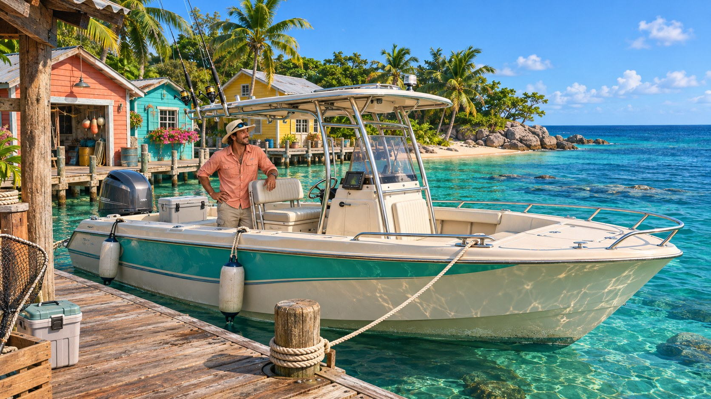

# FISKELAGET visuell assetstandard

Versjon 1.0. Opprettet 4. november 2026.

FISKELAGET skal være vakkert, fargerikt og innbydende. Den visuelle retningen er **fargerik karibisk realisme**: naturlige proporsjoner, troverdige overflater, klart hav og varme tropiske omgivelser. Standarden gjelder både assets vi lager og assets vi henter inn.

## Visuell referanse

Bildet setter retningen for farger, lys, atmosfære og materialer. Det er konseptkunst laget med bildegenereringsverktøyet, ikke et skjermbilde fra spillet eller en ferdig 3D-modell. Detaljer i båtkonstruksjon og utstyr følger kravspesifikasjonen og kontrolleres ved modellering. Originalprompten er lagret [sammen med bildet](assets/references/fiskelaget_visuell_referanse_v1_prompt.txt).

## Farger

| Bruk | Farge | Veiledende sRGB verdi |
| --- | --- | --- |
| Klart gruntvann | Turkis | #27C9C2 |
| Overgang mot dypere vann | Smaragdgrønn | #168D82 |
| Åpent hav | Dyp blå | #1769A5 |
| Strand og varme lyse flater | Lys sand | #F3D7A2 |
| Palmer og vegetasjon | Frodig grønn | #398552 |
| Malte naust og detaljer | Korall | #E97963 |
| Malte naust og detaljer | Solgul | #F1C65D |
| Båtskrog og nøytrale flater | Elfenben | #F6F0DF |

Verdiene er utgangspunkt for fargevalg, ikke krav om at alle flater skal ha nøyaktig samme farge. Lys, våthet og slitasje gir variasjon. De sterkeste fargene brukes i hav, vegetasjon og malte detaljer. Elfenben, sand og treverk gir rolige flater rundt dem. Båtens profil, fiskelinen og kampvarsler skal være lette å se.

## Lys og atmosfære

- Grunnreferansen er klart morgenlys med varm sol og blå himmel.
- Skyggene skal beholde detaljer og farge. Ansikter, snelle og stang skal være lesbare også i skygge.
- Refleksjoner og solglitter skal gi liv uten å skjule line, fisk eller grensesnitt.
- Fargene skal være mettede og balanserte, med bevarte detaljer i lyse flater.
- Fjern bakgrunn skal ha naturlig dybde uten å bli et tungt tåkeslør.

## Form og detaljer

- Modeller følger virkelige proporsjoner og en felles målestokk. Én meter i kildefilen skal tilsvare én meter i spillet.
- Båter skal ha troverdig skrog, cockpit, motorplassering, fortøyning og utstyr.
- Fisk følger artens kroppsform, finner og farger. Størrelsesvarianter skal beholde troverdige proporsjoner.
- Detaljene prioriteres etter spillerens faktiske kameravinkler. Stang, snelle, hender, båtside og fisk nær båten trenger mest omtanke.
- Kanter, skjøter og overganger skal se bearbeidet ut i nærbilder. Små detaljer må være store nok til å overleve vanlig spillavstand.

## Materialer og teksturer

- Bruk fysisk baserte materialer med riktig grunnfarge, ruhet, metallandel og overflatedetalj der det er relevant.
- Grunnfargen skal være fri for innbakte solglimt og harde skygger som låser assetet til én lysretning.
- Glassfiber er svakt blank, stål har tydelige refleksjoner, tre har synlig fiber og mild solslitasje, og tau og stoff har naturlig struktur.
- Våte overflater og fiskeskinn skal ha en annen glans enn tørre flater.
- Teksturer skal ha jevn detaljtetthet mellom objekter og ikke vise tydelige sømmer eller gjentakelser fra vanlige kameravinkler.
- Bruk normalt 2K som arbeidsutgangspunkt for synlige hovedassets. Bruk 4K bare når nærbildet trenger det; mindre objekter kan bruke 512–1K. Flisbare materialer og delte teksturer gjenbrukes.
- Kildefiler beholdes med lag eller redigerbare innstillinger der formatet støtter det. Normaler, ruhet og andre datakart behandles som data, ikke som vanlige fargebilder.

## Hav og bevegelse

- Havet går naturlig fra klart turkis ved grunt vann til dypere blått offshore.
- Bølgene har både rolige større bevegelser og finere krusninger. Skalaen skal passe til båtene.
- Solglitter, refleksjoner og vannets dybde skal komme fra materialet og scenens lys.
- Båter, fisk, liner og utstyr skal reagere sammenhengende. Bevegelsene skal være myke og uten synlige hopp ved løkkens slutt.
- Skum og sprut legges til der skrog, motor eller fisk faktisk forstyrrer vannet.

## Leveranse og navngivning

Bruk Blender til modeller som egner seg for det. Brukeren har gitt klarsignal til å fortsette denne produksjonen uten ny avklaring for hvert asset. Behold en redigerbar `.blend`-kildefil og lever passende spillformat, normalt FBX og eventuelt GLB, sammen med nødvendige teksturer. Følg assetlistens prioritering og oppdater status ved hver leveranse.

Hvert asset får en mappe under `assets/` med ID fra assetlisten, for eksempel `assets/A001_hav/`. Bruk beskrivende filnavn med versjon når vi trenger å beholde en tidligere variant.

Leveransen skal inneholde kildefiler, nødvendige ressurser, en kort bruksbeskrivelse og et bilde eller en annen forhåndsvisning når det hjelper vurderingen. Registrer kilde og bruksrettigheter ved eksterne ressurser.

Hold tre ting tydelig atskilt i statusen: **visuell referanse**, **laget ressurs** og **kontrollert i spillet**. Et vakkert referansebilde betyr ikke at den tilsvarende modellen eller materialet er ferdig integrert.

## Kontroll før ferdigmarkering

- [ ] Assetet passer til referansebildets farger, materialer og realisme.
- [ ] Form og målestokk er riktige sammen med båt, fisker og utstyr.
- [ ] Assetet er kontrollert i både nøytralt lys og spillets morgenlys.
- [ ] Det fungerer fra de faste kameraene der spilleren skal se det.
- [ ] Nødvendige bevegelser og overganger fungerer.
- [ ] Ingen synlige sømmer, feilvendte flater eller forstyrrende gjentakelser står igjen.
- [ ] Samtidige båter og spillere er prøvd når det er relevant. Målbare ytelsesgrenser fastsettes når maskinvaremålet er valgt.
- [ ] Assetet røper ingen bekreftede fangstresultater før minutt 17.
- [ ] Kilde, filsti, kontrollstatus og ferdigdato er ført i assetlisten.

## Arbeidsrekkefølge

Start med A001 havoverflaten. Sammen med lyset setter den fargeopplevelsen i nesten alle fiskescener. Deretter følger lys, kyst og brygge før startbåt og fiskeutstyr. Følg [assetlisten](FISKELAGET_Assetliste.md) for løpende fremdrift.
