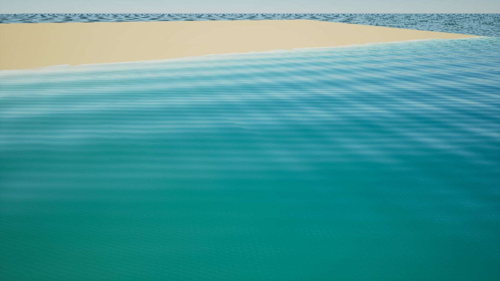

# A001 Havoverflate

Første materialutgave for FISKELAGETs fargerike karibiske hav. Havet bruker et felles bølgemønster med egne innstillinger for marina, korallrev og offshore. Fargene oppstår gjennom vannets lysabsorpsjon, spredning og den faktiske bunndybden.

Visuell retning: [assetstandard v1](../../FISKELAGET_Assetstandard.md) og [referansebilde](../references/fiskelaget_visuell_referanse_v1.jpg).

**Status: Første utgave laget og kontrollert i eget Unreal-prosjekt. Til kontroll før integrasjon i hovedspillet.**

Bildet viser materialet mot en enkel skrånende sandbunn. Landskap, vegetasjon, båt og ferdig scenelys kommer i egne leveranser. Den samlede visuelle kvaliteten skal fortsatt løftes mot referansebildet.

## Innhold

| Ressurs | Bruk |
| --- | --- |
| `unreal/FiskelagetOceanAsset.uproject` | Eget arbeidsprosjekt i Unreal Engine 5.8. |
| `M_FISK_Ocean_v1` | Felles vannmateriale med refleksjon, gjennomsiktighet, bølger og finere krusninger. |
| `MI_FISK_Harbor_v1` | Små, rolige bølger for marinaen. |
| `MI_FISK_Reef_v1` | Utgangspunkt for klart turkis vann over sand og rev. |
| `MI_FISK_Offshore_v1` | Større bølger og blåere, dypere vann. |
| `SM_FISK_OceanGrid64m_v1` | Vannflate på 64 × 64 meter med 0,5 meter mellom punktene. |
| `ocean_grid_64m.obj` | Redigerbar kildegeometri til vannflaten, laget ved bygging. |
| `ocean_waves.hlsl` | Redigerbar bølge- og normalberegning. |
| `build_ocean.py` | Oppretter materialer, geometri og en enkel testscene i arbeidsprosjektet. |
| `capture_preview.py` | Tar forhåndsvisning fra testscenens kamera. |
| `validate_ocean.py` | Kontrollerer shader, materialvarianter og målestokk i arbeidsprosjektet. |
| `build_report.json` | Registrerer motorversjon og bygde ressurser etter vellykket bygging. |

Materialer og geometri ligger under `/Game/Fiskelaget/Water`. Testscenen ligger under `/Game/Fiskelaget/Water/Preview/L_A001_Ocean`.

## Bruk og justering

Åpne arbeidsprosjektet og testscenen for å vurdere materialet. Velg en av de tre materialvariantene og juster bølgehøyde, fart, overflateruhet og krusninger etter kameravinkel og båtstørrelse. Verdiene er visuelle utgangspunkt; de bestemmer ikke båtens fysiske bevegelse.

Når materialet er klart for integrasjon, brukes Unreal Editors **Migrate** på hovedmaterialet, variantene og vanngeometrien til spillets Content-mappe. Behold avhengighetene og kontroller resultatet i spillets lys. Arbeidsprosjektet kan brukes til videre bearbeiding uten å endre spillprosjektet.

Vannflaten må ha tilstrekkelig mange punkter for synlig bølgebevegelse. Flere ruter kan plasseres kant i kant med 6400 centimeter mellom sentrum; bølgene beregnes i verdenskoordinater og følger samme fase over skjøtene. Koble til spillets felles visuelle klokke ved integrasjon hvis vannet skal ha lik bølgefase på alle PC-er.

Gjennomsiktighet og vannfarge trenger havbunn under overflaten og en opplyst scene. Sol og himmel gir refleksjoner; påtegnet glans brukes ikke. Dypt vann vil skjule mer av bunnen enn grunt vann. Ved veldig store avstander trengs en rimeligere havflate og overgang til denne.

Denne leveransen omfatter vannflaten. Kjølvann, skum fra båter, sprut, undervannskamera og fysisk bølgekobling til båter følger egne oppgaver. Materialet må fortsatt prøves i hovedspillet og med flere samtidige båter før A001 kan krysses av.

## Teknisk grunnlag

Materialet bruker motorens [Single Layer Water](https://dev.epicgames.com/documentation/en-us/unreal-engine/single-layer-water-shading-model-in-unreal-engine), som beregner vannets lys og gjennomsiktighet. Opprettingen følger Epics [MaterialEditingLibrary](https://dev.epicgames.com/documentation/en-us/unreal-engine/python-api/class/MaterialEditingLibrary). Ingen eksterne teksturer eller kjøpte ressurser inngår i havmaterialet.

## Kontrollstatus

Se `build_report.json` og `QA.md` for den faktisk gjennomførte kontrollen. A001 står åpen i assetlisten fram til integrasjon og visuell kontroll i hovedspillet.
