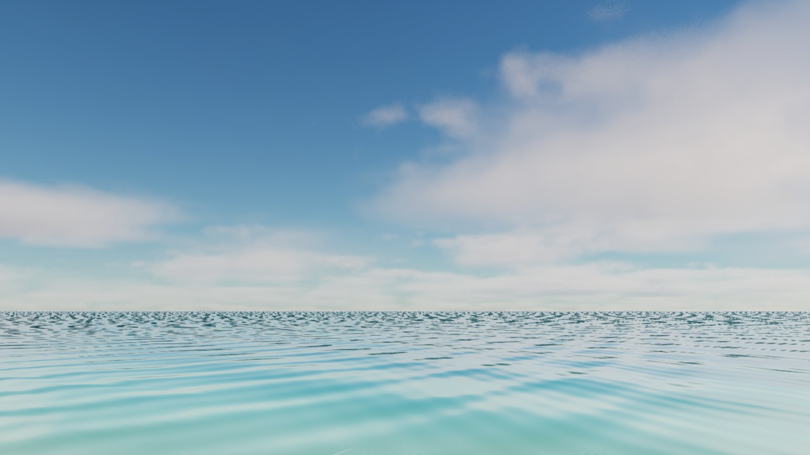
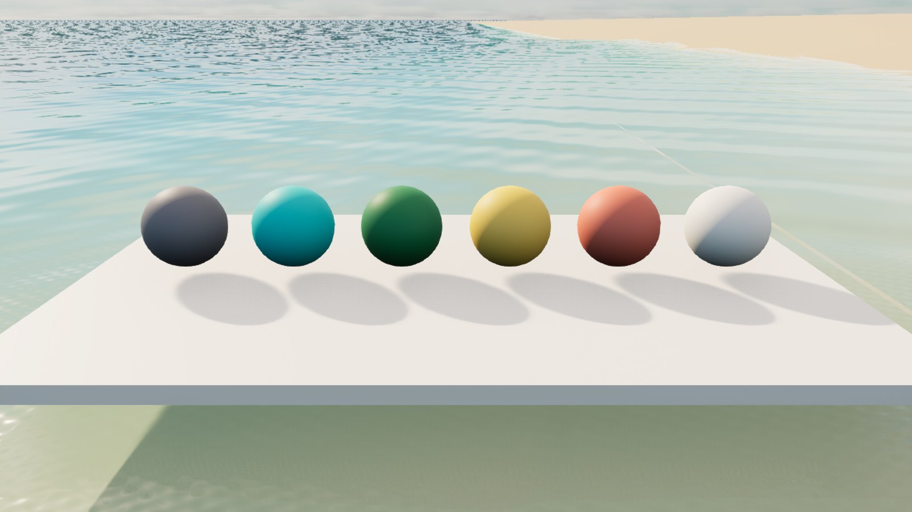

# A002 Himmel og morgenlys

Et gjenbrukbart morgenlys for FISKELAGET: varm sol, blå himmel, lyse skyer, svak dis i det fjerne og fast eksponering. Uttrykket følger [assetstandarden](../../FISKELAGET_Assetstandard.md) og skal bevare spillets turkise vann, varme sand og fargerike bygninger.

**Status: Første utgave laget og kontrollert i eget Unreal-prosjekt. Til kontroll før integrasjon i hovedspillet.**

Opprettet og kontrollert 4. november 2026.

## Forhåndsvisninger

Bildene er tatt direkte i Unreal Engine. Havet er en kopi av A001, og fargekulene og plattformen er hjelpemidler i testscenen. Ferdig øy, båt og marina følger egne oppgaver.

## Innhold

| Ressurs | Bruk |
| --- | --- |
| `unreal/FiskelagetSkyAsset.uproject` | Eget arbeidsprosjekt i Unreal Engine 5.8. |
| `/Game/Fiskelaget/Lighting/L_A002_MorningSky_v1` | Gjenbrukbart delnivå med sol, himmel, omgivelseslys, skyer, dis og eksponering. |
| `/Game/Fiskelaget/Lighting/MI_FISK_MorningClouds_v1` | Materialvariant for lyse skyer uten storm. |
| `/Game/Fiskelaget/Lighting/Preview/L_A002_MorningPreview_v1` | Testscene med A001-vann, to kameraer og fargeprøver. |
| `morning_preset.json` | Redigerbare innstillinger for sol, himmel, skyer og lysbehandling. |
| `build_morning_sky.py` | Oppretter ressursene i det separate arbeidsprosjektet. |
| `capture_preview.py` | Tar de to testbildene fra scenens kameraer. |
| `validate_morning_sky.py` | Leser tilbake og kontrollerer innstillingene i Unreal. |
| `build_report.json` | Motorversjon, ressursstier og innstillinger. |
| `validation_report.json` | Resultat fra faktisk kontroll av innstillingene. |

## Visuelle valg

- Solen står 32 grader over horisonten og bruker et svakt varmt lys på 6000 kelvin.
- Blå atmosfære og lys fra himmelen gir farge og detaljer i skyggene.
- Skyene ligger i et eget lag over havet. Dekning og tetthet kan justeres i materialvarianten.
- Disen starter langt fra kameraet for å gi avstand uten å tilsløre båt og fisking.
- Eksponeringen er låst, slik at bildet beholder samme lysnivå når spilleren bytter mellom himmel og utstyr.
- Glød rundt lyse partier er svak, og linseglimt er slått av.

Innstillingene er en visuell morgenreferanse. De angir ikke et bestemt klokkeslett eller en geografisk solposisjon, og endrer ikke fiskedagens regler eller serverklokke.

## Bruk i hovedspillet

Åpne arbeidsprosjektet og testscenen for å vurdere uttrykket. Bruk Unreal Editors **Migrate** på `L_A002_MorningSky_v1` med avhengigheter når ressursen skal inn i hovedspillet. Legg dette delnivået inn som **Always Loaded** i ønsket spillscene.

Scenen skal ha ett samlet lysoppsett. Eksisterende sol, himmellys, atmosfære og global eksponering må samordnes med A002 ved integrasjon. Solretningen tilpasses de faste kameraene, slik at refleksjoner og solglitter ikke skjuler fiskeline, fisk eller viktige målere.

Himmellyset bruker et opptak av himmelen ved innlasting. Etter endringer i sol, atmosfære eller skyinnstillinger må **Recapture Sky** kjøres på `A002 Sky Fill`, slik at lys i skygger og refleksjoner følger den nye himmelen. Dette er et fast morgenoppsett; en bevegelig døgnsyklus inngår ikke.

Testprosjektets vannressurser er kopier for vurdering og skal ikke erstatte A001 ved migrering av bare morgenlyset. Fargeprøver og kameraer ligger i testscenen, utenfor selve lysdelnivået.

Skyene bruker motorens innebygde volumetriske skyressurser. Ingen betalte eller eksternt nedlastede ressurser er lagt til. Lys og himmel krever ingen nettjeneste.

## Kontrollstatus

Se [QA.md](QA.md) for gjennomførte kontroller og gjenstående arbeid. A002 står som **Til kontroll** i assetlisten. Endelig ferdigmarkering krever også vurdering i hovedspillets kameraer og en relevant ytelsesprøve.

## Teknisk grunnlag

Oppsettet bruker motorens [Sky Atmosphere](https://dev.epicgames.com/documentation/en-us/unreal-engine/sky-atmosphere-component-in-unreal-engine), [Sky Light](https://dev.epicgames.com/documentation/unreal-engine/sky-lights-in-unreal-engine) og innebygde volumetriske skyressurser.
