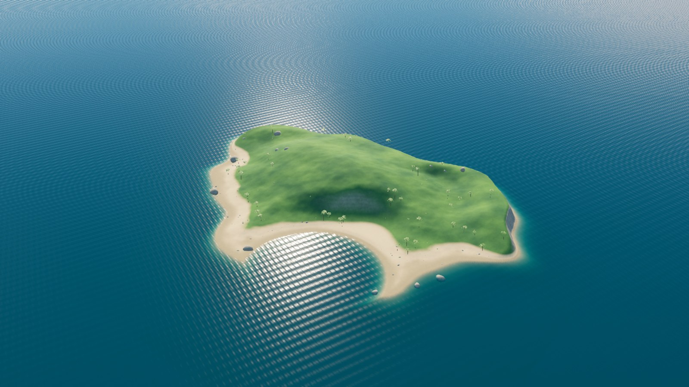
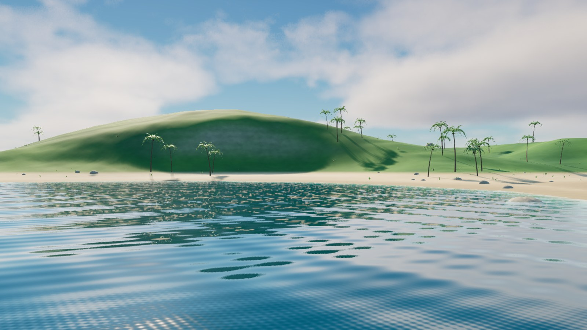

# A003 Øy og kyst

Karibisk prototypeøy med en lun sandbukt, grønne høydedrag, lys klippekyst og grunne overganger til turkist hav. Versjon 2 legger til palmer, busker, gresstuer og flere kystdetaljer. Formen følger [assetstandarden](../../FISKELAGET_Assetstandard.md).

**Status: Versjon 2 laget og kontrollert etter gjenåpning av arbeidsprosjektet. Til kontroll før integrasjon i hovedspillet.**

Opprettet og kontrollert 4. november 2026.

## Forhåndsvisninger

Bildene er tatt direkte i Unreal med kopier av A001-havet og A002-morgenlyset. Se også [palmedetaljen](../A026_vegetasjon/A026_palme_detalj_v1.jpg). Brygger og bygninger følger egne oppgaver.

Bildene fra første utgave beholdes: [oversikt v1](A003_oy_oversikt_v1.jpg), [innseiling v1](A003_fra_sjoen_v1.jpg) og [bukt v1](A003_marinabukt_v1.jpg).

## Detaljer i versjon 2

- 42 palmetrær fordelt på tre varianter, med variasjon i størrelse og retning.
- 45 lave busker og 90 gresstuer ved strand og høydedrag.
- 48 ekstra strandsteiner og 8 større utspring langs klippekysten.
- Vegetasjonens rotpunkter står minst 32 meter fra det foreslåtte marinaankeret.

Modellene til vegetasjonen kan brukes andre steder gjennom [A026-pakken](../A026_vegetasjon/README.md). De nye plasseringene ligger i et eget detaljnivå, slik at de kan redigeres uten å endre selve øymodellen.

## Form og målestokk

Det synlige landarealet strekker seg omtrent 584 meter i øst–vest-retning og 406 meter i nord–sør-retning. Høyeste punkt ligger omtrent 50 meter over vannflaten. Geometrien inkluderer en undervannssokkel, med samlet utstrekning på 760 × 760 meter og en lukket bunn 40 meter under havnivå.

Sandbukta ligger på sørsiden. Den brattere klippekysten ligger hovedsakelig mot nord og øst. Et lavt, flatt parti på landsiden av bukta er foreslått som utgangspunkt for marinaen. Form, størrelse og plassering kan endres ved utprøving av båttrafikk og reisetider.

| Foreslått ankerpunkt | Unreal posisjon i meter |
| --- | --- |
| Land ved marinaen | X −90, Y −60, Z 2,2 |
| Vann ved framtidig brygge | X −90, Y −105, Z 0 |

Havnivået er Z 0. Ankerpunktene er arbeidsforslag til A004 og videre marinaarbeid.

## Ressurser

| Ressurs | Bruk |
| --- | --- |
| `unreal/FiskelagetIslandAsset.uproject` | Eget arbeidsprosjekt i Unreal Engine 5.8. |
| `/Game/Fiskelaget/Island/L_A003_Island_v1` | Gjenbrukbart delnivå med øy og ti plasserte kyststeiner. |
| `SM_FISK_IslandCoast_v1` | Sammenhengende øy, kyst og undervannssokkel. |
| `M_FISK_IslandSurface_v1` | Proseduralt materiale for tørr/våt sand, grønn bakke og kalkstein, styrt av høyde og helning. |
| `SM_FISK_CoastalRock_1_v1` til `3_v1` | Tre redigerbare kyststeinvarianter. |
| `MI_FISK_CoastalRock_v1` | Steinvariant av øymaterialet. |
| `/Game/Fiskelaget/Island/Preview/L_A003_IslandBasePreview_v1` | Grunnscene med hav, morgenlys og tre kameraer. |
| `/Game/Fiskelaget/Island/L_A003_Details_v2` | Palmer, busker, gresstuer og nye steinplasseringer. |
| `/Game/Fiskelaget/Island/Preview/L_A003_TropicalIsland_v2` | Samlet testscene med øy, hav, morgenlys, detaljer og nærbildekamera. |
| `island_preset.json` | Farger, målestokk, havnivå og ankerpunkter. |
| `generate_geometry.py` og OBJ-filene | Redigerbar og gjenskapbar kildegeometri. |
| `island_surface.hlsl` | Kilde til overflatefarger, variasjon og små overflatedetaljer. |
| `build_island.py` | Bygger Unreal-ressursene i arbeidsprosjektet. |
| `validate_geometry.py` | Kontrollerer eksportert geometri for åpne kanter, feilvendte flater og ugyldige normaler. |
| `validate_island.py` | Kontrollerer den importerte ressursen og scenen i Unreal. |

Øymodellen har 208 640 trekanter inkludert undervannssider og bunn. Steinvariantene har 528 trekanter hver. Kildegeometrien bruker centimeter i OBJ; OBJ-formatets Y-retning er vendt før eksport slik at importen får riktig retning i Unreal. Ankerpunktene over bruker Unreal-retninger.

## Bruk i hovedspillet

Åpne arbeidsprosjektet for å vurdere øya i den detaljerte testscenen. Bruk Unreal Editors **Migrate** på `L_A003_Island_v1` og `L_A003_Details_v2` med avhengigheter når øya skal inn i hovedspillet. Delnivåene inneholder terreng, steiner og vegetasjon, mens hav, lys og kameraer ligger i testscenen.

Behold havnivå og målestokk ved første integrasjon. Ved flytting i høyden må materialets `SeaLevelCm` samordnes med havflaten. Fargeparametere og høydegrensen for sand kan justeres uten ny modellimport.

Kollisjon er slått av på terreng og steiner i denne utgaven. Kystkollisjon og navigasjon må bygges og prøves sammen med båtens rutevalg før spillintegrasjonen er ferdig. En stor konveks kollisjonsform rundt hele øya vil også dekke bukta og skal ikke brukes som ferdig løsning.

## Kontrollstatus

Se [kontrollen av versjon 2](QA_v2.md), [details_validation_v2.json](details_validation_v2.json) og vegetasjonens [geometrikontroll](../A026_vegetasjon/geometry_validation.json). Den [opprinnelige geometrikontrollen](QA.md) er også beholdt. Før ferdigmarkering gjenstår blant annet hovedspillintegrasjon, kollisjon, kamerakontroll og ytelsesarbeid.

## Teknisk grunnlag

Modellene er laget fra prosjektets egen kildekode. Ingen kjøpte modeller eller eksterne teksturer inngår. Importen bruker Unreals [AssetImportTask](https://dev.epicgames.com/documentation/en-us/unreal-engine/python-api/class/AssetImportTask), og materialene opprettes med [MaterialEditingLibrary](https://dev.epicgames.com/documentation/en-us/unreal-engine/python-api/class/MaterialEditingLibrary).
