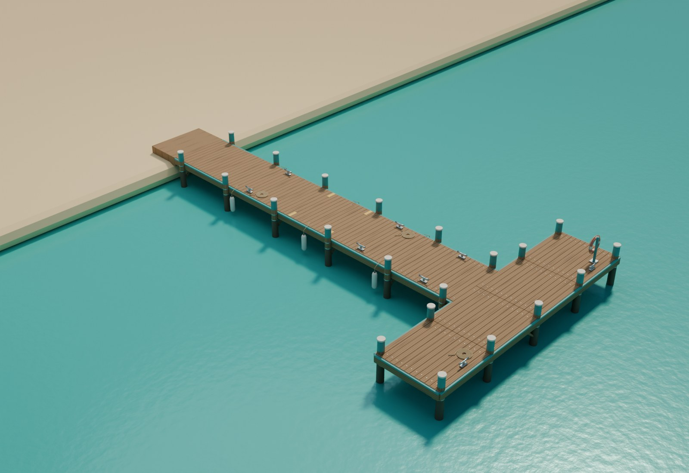
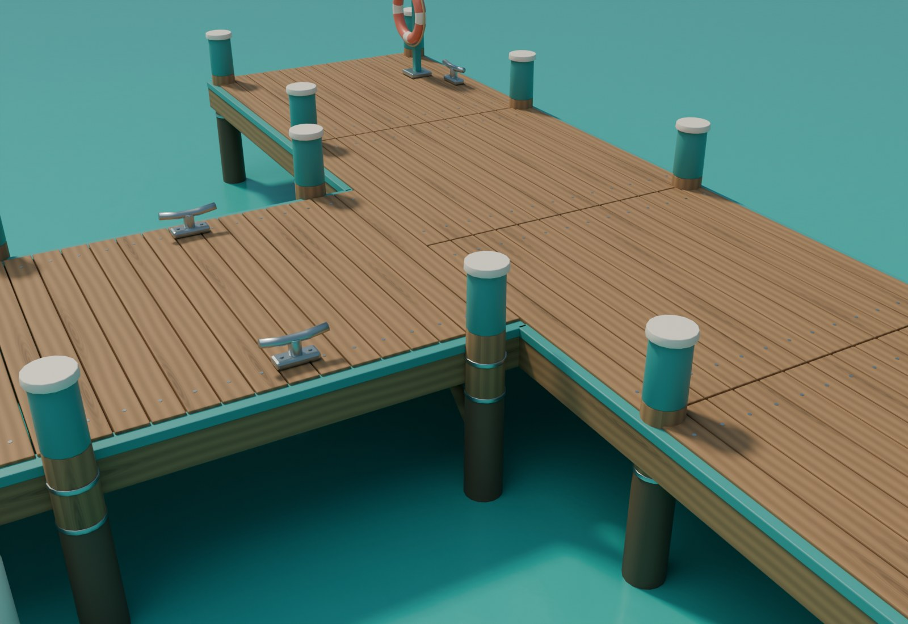

# A004 Første brygge

T-formet trebrygge med turkise kantbord og stolper, lyse fendere og korallfarget redningsring. Avrundede plankekanter, trefiber, synlige innfestinger, stålbeslag og taukveiler gir detaljer nær spillerkameraet. Modellen følger prosjektets [visuelle standard](../../FISKELAGET_Assetstandard.md).

Opprettet 4. november 2026. **Blender-arbeidsleveranse. Integrasjon i hovedspillet gjenstår.**

## Forhåndsvisning

Bildene rendres fra selve 3D-modellen i Blender. Vann, sand, landingsplate og lys er presentasjonsmiljø; de inngår ikke i eksporten til spillet. Hav og øy i hovedspillet skal bruke A001 og A003.

## Mål og funksjon

| Del | Mål |
| --- | --- |
| Rett bryggestamme | 3 × 18 meter |
| T-hode | 12 × 3 meter |
| Samlet dekklengde | 21 meter |
| Dekkhøyde over modellens havnivå | 1,35 meter |
| Merket ombordstigningsområde | Y 8,5–10,9 meter, på begge sider |

Havnivået er lokal Z 0. Origo ligger på havnivå ved inngangen fra land. Lokal +Y peker fra land mot T-hodet. Modellen bruker meter; eksporten bevarer fysisk størrelse.

Brygga har 21 stolper, 8 fortøyningsklamper, 6 hengende fendere, 3 taukveiler og én redningsring. Gule kantmarkeringer viser åpningen for ombordstigning. Taukveiler og klamper ligger utenfor dette området. Fendere og festetau inngår i samme statiske modell i første utgave.

Dekkhøyden er et arbeidsvalg og må prøves sammen med startbåtens fribord, spillerkameraet og ombordstigningen. Landforbindelse, tidevann, dybde og stolpenes kontakt med havbunnen tilpasses når brygga plasseres på A003-øya.

## Filer

| Fil | Bruk |
| --- | --- |
| `FISKELAGET_A004_Brygge_v1.blend` | Redigerbar kilde med separate planker, stolper, beslag og tau; pakkede teksturer. |
| `exports/SM_FISK_FirstPier_v1.fbx` | Spillmodell, to enkle kollisjonsbokser og fem ankerpunkter. |
| `exports/SM_FISK_FirstPier_v1.glb` | Modell med innebygde PBR-materialer og teksturer for visning og gjenbruk. |
| `exports/SM_FISK_FirstPier_LOD1_v1.fbx` | Forenklet avstandsmodell som utgangspunkt for LOD-arbeid. |
| `textures/` | Sømløse 1K-kart for trefarge, ruhet og normaler. |
| `build_blender.py` | Gjenskaper geometri, materialer, eksportfiler og bilder. |
| `validate_blender.py` | Gjenåpner kildefilen og kontrollerer geometri og eksportstørrelse. |
| `build_report.json` | Mål, ankerpunkter og modellens faktiske mengder. |
| `validation_report.json` | Resultatet fra kontroll av den lagrede leveransen. |

Blender-filen skiller mellom redigerbare deler, sammenføyd spillmodell, kollisjon, ankerpunkter og presentasjonsmiljø. Sammenføyd modell og kollisjon er skjult i vanlig visning for å unngå doble flater. Teksturene er både pakket i kildefilen og lagret ved siden av eksportene.

Normalteksturen bruker OpenGL-retning. Ved manuell bruk i Unreal kontrolleres den grønne kanalen, og **Flip Green Channel** brukes dersom materialimporten ikke gjør om retningen. Ruhet og normaler behandles som data uten sRGB. Farger bruker sRGB. Malte flater, gummi, tau og stål har egne PBR-materialer; stålet har metallandel 1. Treets UV-er følger den enkelte plankens lengde.

## Bruk i Unreal

Importer FBX som én statisk modell med egen kollisjon. De to `UCX_SM_FISK_FirstPier_v1_*`-boksene følger den rette stammen og T-hodet og gir sammenhengende gangflater. Undervannsstolper, fendere, klamper og redningsring trenger egen kollisjonsvurdering dersom spillmekanikken skal berøre dem. Automatisk stor konveks innpakning rundt hele T-formen må unngås fordi den kan sperre vannet ved siden av stammen.

Ankerpunktene heter `SOCKET_Entry`, `SOCKET_Board_Port`, `SOCKET_Board_Starboard`, `SOCKET_T_Head` og `SOCKET_Waterline`. Navn og posisjoner er med i FBX; opprettelse som brukbare Unreal-sockets kontrolleres ved import. Ombordstigningens regler og avstand til båten tilhører spillintegrasjonen.

Velg samme fysiske mål ved import og kontroller 3 meter stammebredde. Materialene skal vurderes i A002-morgenlyset. FBX-overføring av materialer kan kreve ny kobling av PBR-kartene. GLB inneholder materialkoblingene for uavhengig vurdering.

## Kilde og kontroll

Geometri og teksturer er laget for FISKELAGET fra den medfølgende kilden. Ingen eksterne modeller, teksturpakker eller skrifter inngår. Se [QA.md](QA.md) for utførte kontroller og det som gjenstår før punktet kan krysses av i assetlisten.
