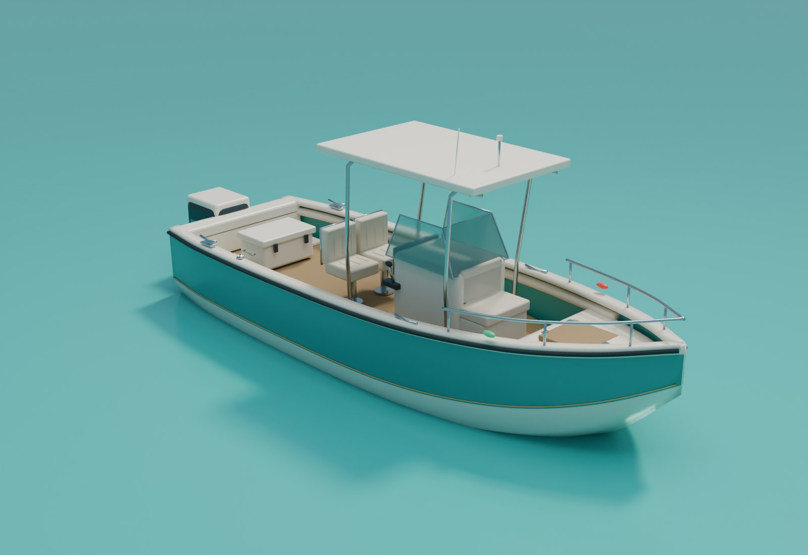
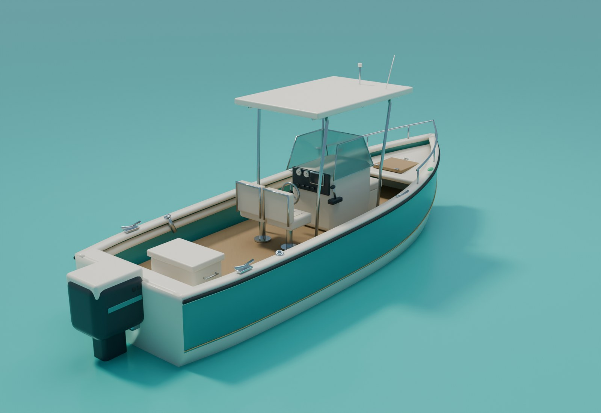
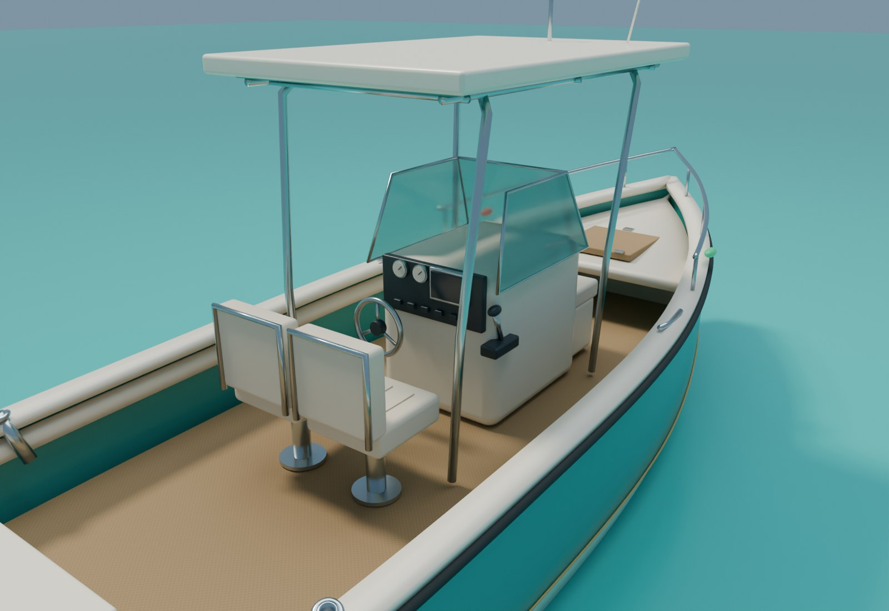

# A005 Startbåt

Original fiskebåt med midtkonsoll, turkist skrog, lys innredning og én påhengsmotor. Skroglengden er 7,9248 meter, omtrent 26 fot. To stangfester og to fiskeankerpunkter følger kravspesifikasjonens kapasitet for startbåten. Modellen er laget i Blender og følger prosjektets [visuelle standard](../../FISKELAGET_Assetstandard.md).

Opprettet 4. november 2026. **Arbeidsleveranse i Blender. Integrasjon og kontroll i hovedspillet gjenstår.**

## Bilder av modellen

Bildene rendres fra 3D-modellen i Blender. Det turkise vannet og lyset er et eget presentasjonsmiljø. Bildene er ikke tatt i hovedspillet. En [visning i nøytralt lys](A005_noytralt_lys_v1.jpg) følger leveransen.

## Innhold og mål

| Egenskap | Leveranse |
| --- | --- |
| Nominell skroglengde | 7,9248 meter; motor og detaljer kommer i tillegg. |
| Bredde som designutgangspunkt | 2,64 meter; se kontrollrapporten for målt bredde. |
| Havnivå | Lokal Z 0. |
| Cockpitgulv | Lokal Z 0,52 meter. |
| Kapasitet fra kravspesifikasjonen | To spillere og to aktive stenger totalt. |
| Skrog | Sammenhengende, tykk skallmodell med kjøl, knekkspant, stigende baug og åpen cockpit. |
| Innredning | Sklisikkert gulv, to førerseter, frontsete, lukkede luker og lukket oppbevaring akter. |
| Førerplass | Ratt, gasspak, instrumenter, brytere og skjerm uten fangstdata. |
| Overbygg | Soltak med stålramme, vindskjerm, lanterner og antenne. |
| Fiskeutstyr | To hule stangfester i rekka; komplette stenger, sneller, liner og landingsutstyr følger egne assetpunkter. |
| Motor | Én egenprodusert påhengsmotor med separat svingakse og trebladet propell. |

Bredde, skrogform, dekkhøyder og motorutforming er visuelle arbeidsvalg. Modellen er ikke en kopi av en bestemt kommersiell båt. Flyteegenskaper, motorkraft, kapasitet og hastighet bestemmes av spillets systemer. Den lukkede oppbevaringen viser ingen fangstresultater.

## Kildefil og spillfiler

| Fil | Bruk |
| --- | --- |
| `FISKELAGET_A005_Startbat_v1.blend` | Redigerbar Blender-kilde med separate komponenter, pakkede teksturer og presentasjonskameraer. |
| `exports/FISK_StartBoat_v1.fbx` | Separate spillmodeller for båt, motor og propell, ankerpunkter og tre enkle skrogkollisjoner. |
| `exports/FISK_StartBoat_v1.glb` | Samme tre synlige modeller, PBR-materialer, teksturer, hierarki og ankerpunkter. |
| `exports/SM_FISK_StartBoat_Hull_LOD1_v1.fbx` | Forenklet avstandsmodell for båt og innredning. |
| `textures/` | To delte 2K-kart for sklisikkert dekk: farge og OpenGL-normaler. |
| `boat_preset.json` | Mål, kapasitet og fargevalg. |
| `build_blender.py` | Gjenskaper modellen, materialene, eksportene og bildene. |
| `capture_preview.py` | Gjenåpner den lagrede Blender-filen og tar nye bilder i morgenlys og nøytralt lys. |
| `validate_blender.py` | Kontrollerer lagret Blender-fil og leser eksportene inn i tomme scener. |
| `build_report.json` | Modellnavn, mengder, dreiepunkter og ankerposisjoner. |
| `validation_report.json` | Faktiske resultater fra leveransekontrollen. |

Blender-kilden viser de redigerbare delene. Sammenføyde spillmodeller, kollisjon og ankerpunkter ligger i egne samlinger. Spillmodellene er skjult i vanlig visning for å unngå doble flater. Aktiver samlingen `02_A005_Game_Meshes` og skjul kildedelene når hierarkiet skal undersøkes.

## Retninger og bevegelige deler

Alle kildemål bruker meter. Origo er ved båtens lengdemidtpunkt på modellens havnivå. +Y peker mot baugen, +X mot styrbord og +Z opp. Fortsett med disse retningene gjennom første import og kontroller dem mot hovedspillets båtrot.

`SM_FISK_StartBoat_Hull_v1` har dreiepunkt i origo. `SM_FISK_StartBoat_Engine_v1` har eget dreiepunkt ved motorfestet, omtrent X 0, Y −3,98, Z 0,60 meter. `SM_FISK_StartBoat_Propeller_v1` er underordnet motoren og har senter omtrent X 0, Y −4,69, Z −0,87 meter. Motoren svinger rundt Z; propellen roterer rundt lokal Y. Flytt hele båten med `FISK_StartBoat_Root`.

To illustrerende Blender-handlinger, `A005_Steering_Demo` og `A005_Propeller_Demo`, er bevart uten å være aktive i hvileposisjonen. De viser bevegelsesaksene og inngår ikke i spillfilenes animasjon. Motorstyring, trim, propellhastighet og eventuell rattkobling kobles til spillogikken senere.

Fjorten ankerpunkter dekker ombordstigning på begge sider, fiskernes plasseringer, førerplass, landing, motor, propell og foreslåtte faste kameraer. `SOCKET_Rod_Port` og `SOCKET_Rod_Starboard` har retning som følger stangrørene. Koordinater og retninger står i byggeloggen. Dette er plassforslag fram til figurer, stenger og kameraer er prøvd sammen.

## Materialer og import

Skrog og innredning bruker fysisk baserte materialer for glassfiber, gummi, setetrekk, stål og glass. Fargene følger elfenben og turkis fra assetstandarden. Dekket har sømløse 2K-kart med jevn UV-skala. Normaler behandles som data uten sRGB; grunnfarge bruker sRGB. Ved manuell normalimport til Unreal kontrolleres behovet for **Flip Green Channel**, siden kildekartet bruker OpenGL-retning.

Importer FBX uten å slå sammen båt, motor og propell til én modell. Behold dreiepunkter og hierarki eller gjenskap dem i båtens Blueprint. Bruk medfølgende `UCX_`-former som foreløpig båtkollisjon. De dekker det nedre skroget i tre deler og er ikke separate gangflater for spilleren. Stolper, bølger og bryggekant må prøves sammen med den faktiske båtbevegelsen.

Ankerpunktenes overføring til brukbare Unreal-sockets, materialkoblinger og gjennomsiktig glass kontrolleres ved import. Blender-eksport er ikke en ferdig Unreal-båt. Spesielt glass kan trenge et eget Unreal-materiale. LOD-overganger og en mer kompakt materialinndeling vurderes ut fra ytelsesmålet.

## Kilde og kontroll

Modell og teksturer er laget for FISKELAGET fra den medfølgende kilden. Ingen eksterne båter, varemerker eller teksturpakker inngår. Se [QA.md](QA.md) for kontrollstatus og gjenstående integrasjon.
