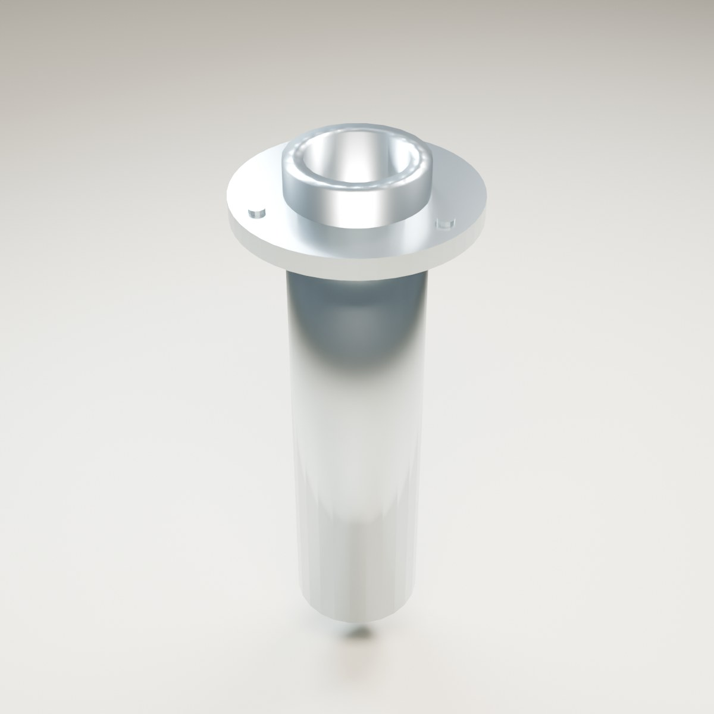

# A006 Stangholder

Gjenbrukbar stangholder for innfelling i båtrekka. Modellen har et hult stålrør, monteringsflens med tre synlige skruehoder og en tverrpinne som støtter stangens ende. Den bygger videre på prosjektets egen rørgeometri fra A005.

Opprettet 4. november 2026. **Til kontroll før samspill med stang, line, kamera og hovedspillet.**

Bildet er rendret fra 3D-modellen i Blender med studiobelysning. Bakgrunn og lys inngår ikke i spillfilene.

## Mål og montering

| Egenskap | Mål |
| --- | --- |
| Innvendig rørdiameter | 54 mm |
| Utvendig rørdiameter | 76 mm |
| Monteringsflens | Diameter 132 mm |
| Rørdybde under flensens midtplan | 280 mm |
| Tverrpinnens senter | Z −245 mm |
| Stanganker | Lokal X 0, Y 0, Z 30 mm |
| Spillmodell | 768 trekanter, ett stålmateriale |

Origo ligger i flensens midtplan. +Z er retningen stanga peker ut av holderen; røret går ned langs −Z. Kilden bruker meter. Ved innfelling må båtrekka ha åpning rundt røret. Det er ikke laget en skjult utsparing eller automatisk hullskjæring i båten.

Bruk båtens to stangankre som plasseringsgrunnlag, med samme utover- og akteroverrettede helning som rørene på A005. Tilpass flensens midtpunkt til rekka før stanga plasseres med `SOCKET_RodSeat`. Stanghåndtakets diameter, innstikkslengde og posisjon mot tverrpinnen må kontrolleres sammen med A007. Ingen stang eller line følger denne leveransen.

A005 har to enklere, innebygde rør med avrundede flenser. Denne gjenbrukbare varianten legger til flat monteringsflens, skruehoder og bunnpinne. Erstatt de innebygde rørene ved integrasjon dersom A006 brukes; unngå doble modeller på samme sted.

## Filer

| Fil | Bruk |
| --- | --- |
| `FISKELAGET_A006_Stangholder_v1.blend` | Redigerbar kilde med seks komponenter og eget presentasjonsmiljø. |
| `exports/SM_FISK_FlushRodHolder_v1.fbx` | Statisk spillmodell og stanganker. |
| `exports/SM_FISK_FlushRodHolder_v1.glb` | Modell med PBR-materiale og stanganker. |
| `build_blender.py` | Gjenskaper modellen fra prosjektets A005-kilde og legger til flens, skruer og pinne. |
| `validate_blender.py` | Gjenåpner Blender-kilden og kontrollerer eksportene. |
| `build_report.json` | Modellmål og mengder. |
| `validation_report.json` | Geometri- og eksportkontroll. |

Stålet bruker prosjektets eget PBR-materiale med metallandel 1. Det er ingen eksterne teksturer. Ved Unreal-import kontrolleres at stålet beholder metallandel og ruhet, og at ankeret får riktig posisjon og retning. Kollisjon mot stang og line håndteres i spillintegrasjonen; en konveks kollisjonsform som fyller røråpningen er uegnet dersom stanga skal føres fysisk ned i røret.

## Kontrollstatus

Kildefil og eksportgeometri er kontrollert etter gjenåpning. Se [QA.md](QA.md). Automatisk agnbevegelse, napp, stangbøy og samspill med kamera er spillfunksjoner og følger ikke av den statiske modellen alene.
