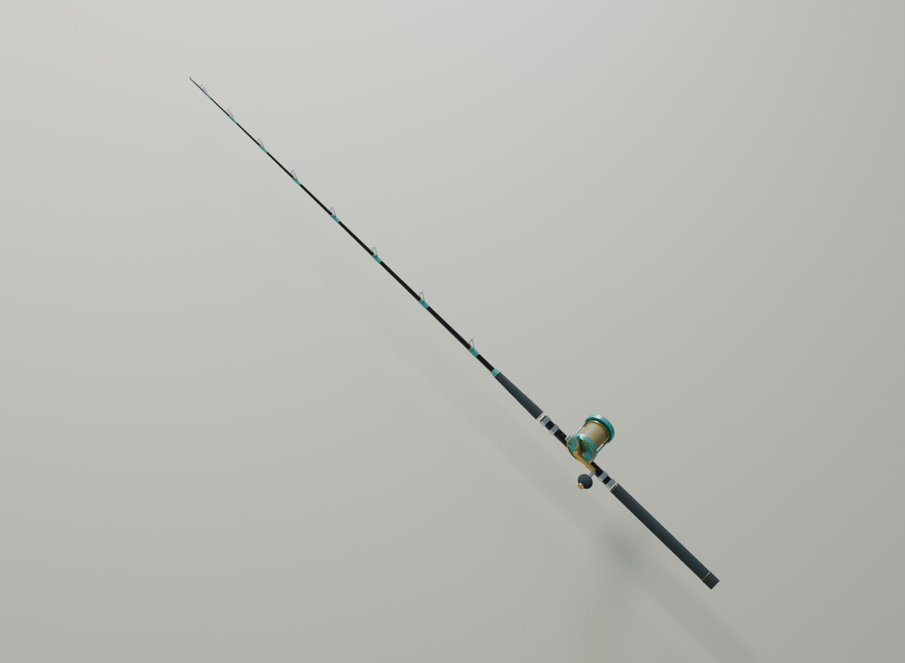
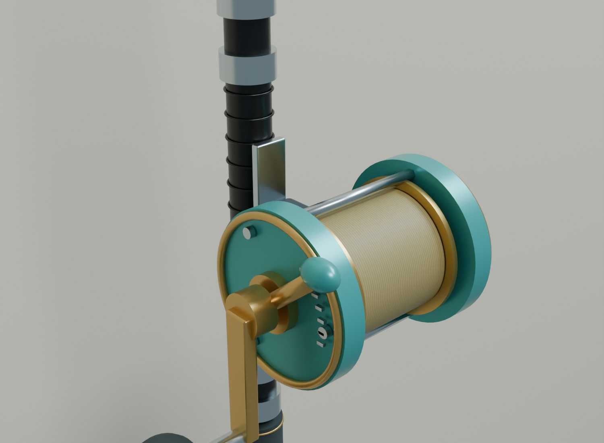
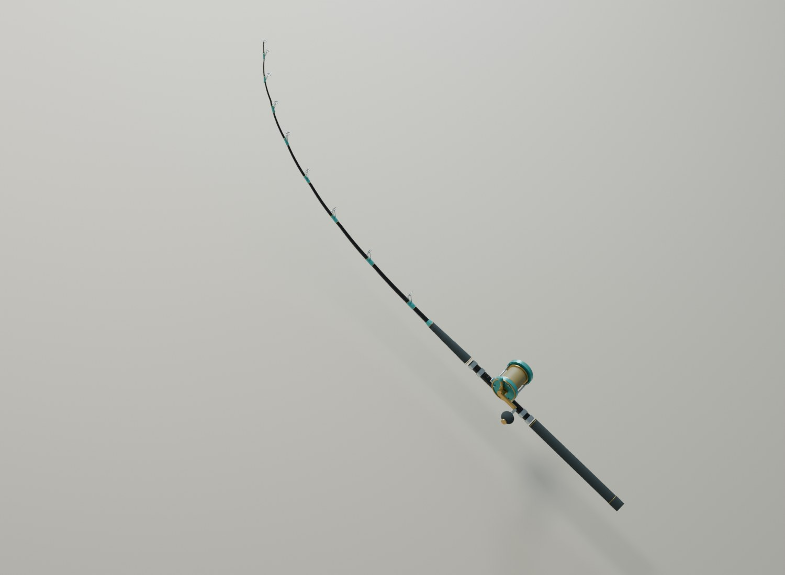

# A007 Første fiskestang

Original båtstang på 1,90 meter med mørk grafitt, turkise surringer, metallringer, EVA-grep og snellefeste. Stanga har en faktisk skjelettrigg med bevegelig stangemne og stabile grep. Den leveres sammen med en visningskopi av [A008-snella](../A008_snelle/README.md).

Opprettet 4. november 2026. **Til kontroll før integrasjon og fisketest i hovedspillet.**

## Bilder fra Blender

Bildene er tatt fra den gjenåpnede Blender-kilden. Bøybildet viser den deformerte spillmodellen. Snella er et eget asset og inngår ikke i stangas FBX/GLB. Bakgrunn og studiolys er bare til vurdering.

## Mål og montering

Lokal +Z går fra stangenden til tuppen. +Y er siden med snelle og føringsringer, og +X følger snellas spoleakse. Origo ligger nederst på stangenden. Nominell stanglengde er 1,90 meter; metallringen på tuppen gir omtrent én millimeter ekstra utstrekning.

Målt største diameter på den nedre delen er 34,4 mm. A006-holderens innvendige diameter er 54 mm, som gir 19,6 mm klaring over diameteren. Dette er en kontroll av mål, og endelig innstikksdybde og kontakt med holderens bunnpinne må tilpasses ved montering. `SOCKET_Holder` er et referansepunkt på det nedre grepet.

`SOCKET_Reel` ligger ved X 0, Y 0,013, Z 0,50 meter. A008-snellas rot er plassert her i forhåndsvisningen. `SOCKET_RearHand` og `SOCKET_FrontHand` angir arbeidsforslag til håndplassering. Figuren og håndanimasjonene prøves sammen med disse punktene senere.

## Bøy og lineføring

Riggen har åtte bein: `GripRoot` og `Flex_01` til `Flex_07`. Grep og snellefeste følger rotbeinet. Stangemnet har normaliserte skinnevekter langs de sju bøyeseksjonene. Føringsringene følger hver sin seksjon som stive deler.

Handlingen `A007_Load_Demo` har disse posene ved 30 bilder per sekund:

| Bilde | Pose |
| --- | --- |
| 1 | Ubelastet |
| 31 | Moderat bøy |
| 61 | Større bøy |
| 91 | Tilbake til ubelastet |

Posene viser animasjonsmuligheten og er ikke kalibrert mot fiskens vekt eller linekraft. I den største posen flytter tuppen seg omtrent 42 cm mot +Y og 15 cm nedover; grepene står stille. Spillet må koble bøyen til belastning, pumping og lineføring.

Ni ankerpunkter, `SOCKET_Guide_01` til `SOCKET_Guide_08` og `SOCKET_Tip`, følger føringsringene gjennom bøyen. De er klare som plasseringsgrunnlag for A009-fiskelinen. Selve fiskelinen, kroken og styring av slakk inngår ikke i denne leveransen.

## Leveranse

| Fil | Bruk |
| --- | --- |
| `FISKELAGET_A007_Fiskestang_v1.blend` | Redigerbar kilde, rigget spillmodell, belastningshandling og visning med A008. |
| `exports/SK_FISK_BoatRod_v1.fbx` | Skjelettmodell med animasjon og ankerpunkter. |
| `exports/SK_FISK_BoatRod_v1.glb` | Skjelettmodell, materialer, animasjon og ankerpunkter. |
| `textures/T_FISK_Rod_CarbonWeave_1K.png` | Eget sømløst fargekart for grafittuttrykket. |
| `build_blender.py` | Gjenskaper stang, rigg og eksporter; bruker den lagrede A008-kilden til visningskopien. |
| `equipment_common.py` | Felles modellhjelpere for A007 og A008. |
| `validate_equipment.py` | Kontrollerer begge assetene og prøver eksportene i tomme scener. |
| `capture_equipment.py` | Tar bilder fra lagrede Blender-filer. |
| `build_report.json`, `validation_report.json` | Mål, mengder og faktiske kontrollresultater. |

Den riggede modellen vises som standard i Blender. De 85 redigerbare kildedelene ligger skjult i `01_A007_Editable_Rod`. Skjul spillmodellen og vis kildesamlingen når enkeltdelene skal redigeres. Visningskopien av snella ligger i en egen samling og er utelatt fra stangeksportene.

Ved Unreal-import brukes skjelettimport med animasjon og medfølgende bein. Kontroller rotretning, materialkoblinger og overføringen av ankerpunktene. Et eget Animation Blueprint eller prosedyrestyring må knytte bøyen til spillets hendelser. Materialer, detaljnivåer og kamerastørrelse vurderes etter innlegging i spillet.

Se [QA.md](QA.md). Modeller, rigg og tekstur kommer fra prosjektets egen kilde; ingen eksterne stangmodeller eller teksturpakker inngår.
