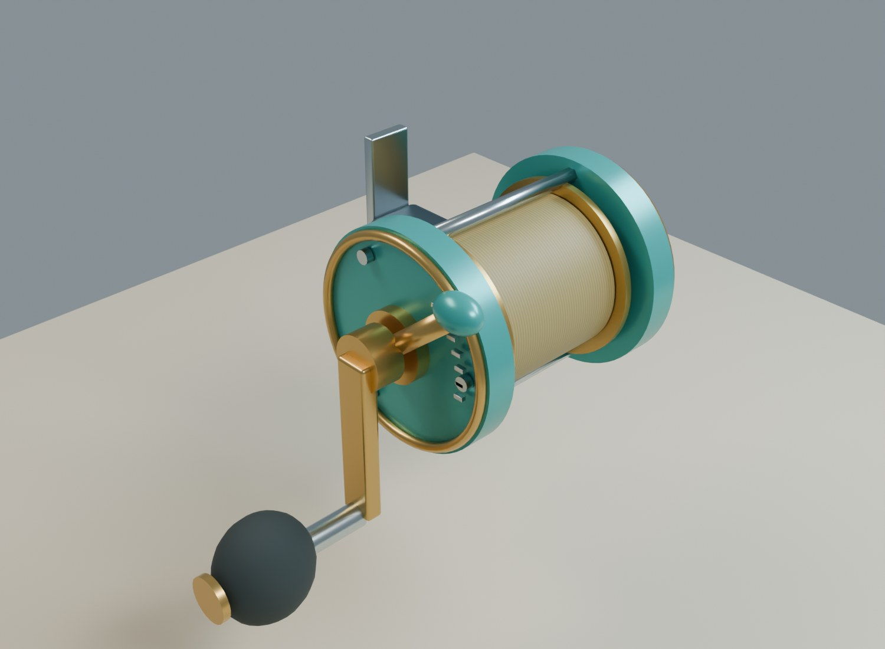

# A008 Første snelle

Original havfiskesnelle med turkise sideplater, gulldetaljer, stålramme, teksturert linespole og mørkt kraftgrep. Spole, sveiv, håndtak og bremsespak er egne bevegelige deler. Snella passer på [A007-båtstangas](../A007_fiskestang/README.md) modellerte snellefeste.

Opprettet 4. november 2026. **Til kontroll før kobling til line, betjening og hovedspill.**

Bildet viser den faktiske 3D-modellen i studiobelysning. Den er også vist montert på A007 i stangas forhåndsvisninger.

## Oppbygning og retninger

Kilden bruker meter. Origo ligger ved snellefotens monteringsflate, med +Z langs stanga og +Y fra stanga mot snellehuset. +X er retningen på spoleaksen og mot sveivsiden.

| Spillmodell | Funksjon |
| --- | --- |
| `SM_FISK_Reel_Body_v1` | Fot, ramme, sideplater, lagersentre og markeringer. |
| `SM_FISK_Reel_Spool_v1` | Linespole med flenser og aksel. Roterer rundt lokal X. |
| `SM_FISK_Reel_Crank_v1` | Sveiv og håndtaksaksel. Roterer rundt lokal X. |
| `SM_FISK_Reel_Knob_v1` | Kraftgrep, underordnet sveiva, med egen lokal X-rotasjon. |
| `SM_FISK_Reel_Drag_v1` | Bremsespak med eget X-dreiepunkt. |

Hele snella flyttes med `FISK_Reel_Root`. Ved montering på A007 legges denne roten ved `SOCKET_Reel`. Snellefoten har modellerte anleggsflater mot stanga; endelig låsing og plass til fingrene prøves sammen med figur og animasjoner.

Seks ankre viser snellefot, lineutgang og de fire dreieaksene. Spolens visuelle linepakke er en teksturert overflate; den er ikke en simulert fiskeline. A009 bygger videre fra `SOCKET_LineExit` mot stangas føringsringer.

## Bevegelse og leveranse

Fire inaktive Blender-handlinger, `A008_Spool_Demo`, `A008_Crank_Demo`, `A008_Knob_Demo` og `A008_Drag_Demo`, viser de separate bevegelsene. Tilordne ønsket handling til riktig spilldel for å prøve den. Handlingenes relative hastigheter er demonstrasjonsverdier. Utveksling, innsveiving, brems og første utras kobles til spillogikken senere.

| Fil | Bruk |
| --- | --- |
| `FISKELAGET_A008_Snelle_v1.blend` | Redigerbar kilde med 35 komponenter, fem spillmodeller og demonstrasjonshandlinger. |
| `exports/FISK_Reel_v1.fbx` | Fem separate deler med dreiepunkter, hierarki og ankerpunkter. |
| `exports/FISK_Reel_v1.glb` | Samme deler med PBR-materialer og innebygd tekstur. |
| `textures/T_FISK_WoundLine_BaseColor_1K.png` | Sømløs, egenprodusert linepakke. |
| `build_blender.py` | Gjenskaper kilde og eksporter; bruker felles hjelpere fra A007-mappen. |
| `build_report.json`, `validation_report.json` | Mengder, akser, mål og kontrollresultater. |

Spillfilene inneholder separate deler i hvileposisjon. Demonstrasjonshandlingene følger Blender-kilden; spillet styrer delene direkte. Behold de separate dreiepunktene ved Unreal-import. Koble kraftgrepet til sveiva slik at det følger sveivbevegelsen og kan rotere om egen aksel.

Vanlig Blender-visning viser de redigerbare kildedelene. Slå på samlingen med spillmodeller og skjul kildedelene når mekanismene skal prøves. Modellen har 7 428 trekanter fordelt på fem spilldeler. Metall, maling og EVA bruker egne PBR-materialer.

Se [QA.md](QA.md). Ingen eksterne modeller, varemerker eller teksturpakker inngår.
