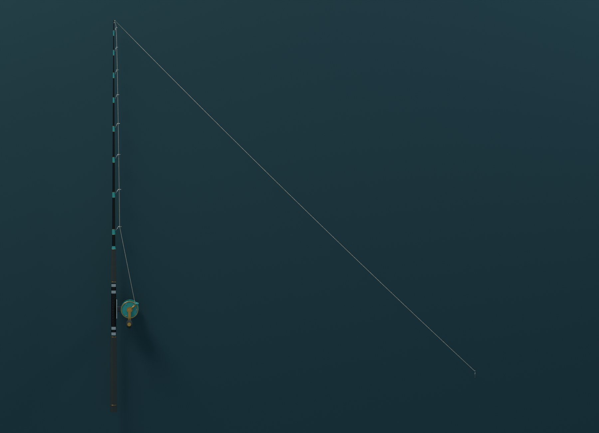
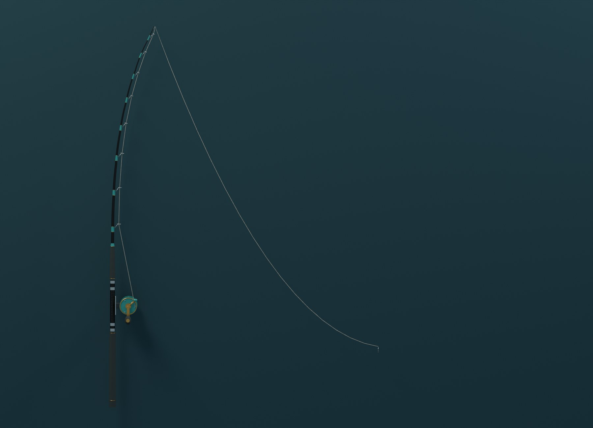
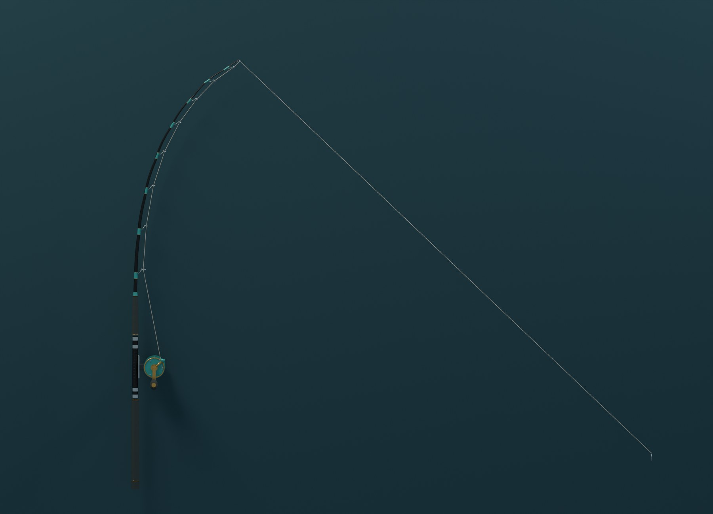
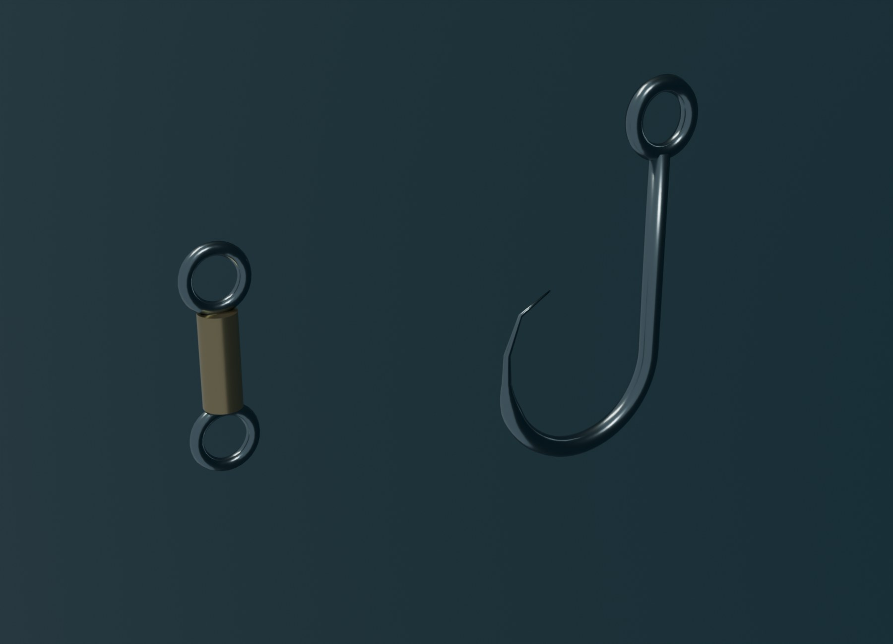

# A009 Fiskeline og krok

Fiskeline med redigerbar styring i Blender, separat krok og svivel. Linen følger A007-stangas ni føringsringer og A008-snellas lineutgang, også når stanga bøyes. En demonstrasjon viser stram line, slakk og en belastet stang.

Opprettet 4. november 2026. **Til kontroll før integrasjon i hovedspillet.**

## Bilder av modellen

Bildene tas fra den lagrede Blender-filen. Stang og snelle er visningskopier av A007 og A008. De inngår ikke i denne leveransens eksportfiler.

## Redigerbar line i Blender

`CURVE_FISK_LiveLine_v1` har 26 styringspunkter. Første punkt følger snellas lineutgang. De neste ni følger føringsringene, og 16 punkter beskriver det frie strekket fram til kroken. Blender-koblinger og drivere oppdaterer linen uten et separat bakgrunnsskript.

Flytt `CTRL_HookTarget` for å endre krokens plassering. Egenskapen `SlackM` styrer siget midt på det frie strekket. Kroken i demonstrasjonen følger endepunktet med øyet på linen. Stangbøyen bruker A007-riggen.

| Bilde ved 30 bilder per sekund | Tilstand |
| --- | --- |
| 1 | Nesten stram line, med 2 cm visuelt sig. |
| 31 | Slakk line, med 35 cm sig. |
| 61 | Stram line og bøyd stang. |
| 91 | Tilbake til startposisjonen. |

Diameteren er 1 mm som et visuelt arbeidsvalg. Materialet er lyst slik at linen kan vurderes mot bakgrunnen. Tykkelse på skjermen, glans og synlighet over vann må tilpasses spillerkameraet. Demonstrasjonen har ingen beregning av vannmotstand, strekkraft, linebrudd eller faktisk linelengde på snella.

## Krok og svivel

Kroken har et åpent øye, buet ståltråd og en innovervendt, avsmalnende spiss. Svivelen er en separat del med to øyer. Begge har lokale ankerpunkter, blant annet `SOCKET_HookEye`, `SOCKET_BaitAttachment` og `SOCKET_SwivelTop`. Plassering mot A010-agnfisken og selve lineknuten kontrolleres ved sammensetting.

## Leveranse

| Fil | Bruk |
| --- | --- |
| `FISKELAGET_A009_LineOgKrok_v1.blend` | Selvstendig Blender-scene med levende line, stang-/snellereferanser, krok og redigerbare kontroller. |
| `exports/FISK_HookAndSwivel_v1.fbx` og `.glb` | To separate maskemodeller og fem ankerpunkter. |
| `exports/FISK_LineStates_v1.fbx` og `.glb` | Tre separate, bakte linemodeller: `Taut`, `Slack` og `Loaded`. |
| `build_report.json` | Styringspunktenes posisjoner for hver tilstand, materialmengder og modellnavn. |
| `build_blender.py` | Gjenskaper scenen og eksportene med kildene fra A007/A008. |
| `validate_assets.py` | Kontrollerer A009–A011 og prøver eksportene i tomme scener. |
| `capture_assets.py` | Tar bilder fra de lagrede Blender-filene. |
| `validation_report.json` | Resultat fra geometri-, line- og eksportkontroll. |

De tre eksporterte linemodellene er alternative øyeblikksbilder. Bruk én tilstand om gangen ved vurdering. Spillets bevegelige line må bygges med løpende oppdatering av snelleutgang, føringsringer, krok og slakk. Blender-driverne blir ikke automatisk et Unreal-system. Koordinatene og oppbygningen her gir et kontrollert utgangspunkt for den implementasjonen.

Krok og svivel har hver sin lokale modell ved origo og plasseres separat. I den vanlige Blender-visningen vises en kopi av kroken ved lineenden. Egen makrovisning viser de to løse delene.

Se [QA.md](QA.md). Ingen eksterne modeller eller teksturer inngår.
