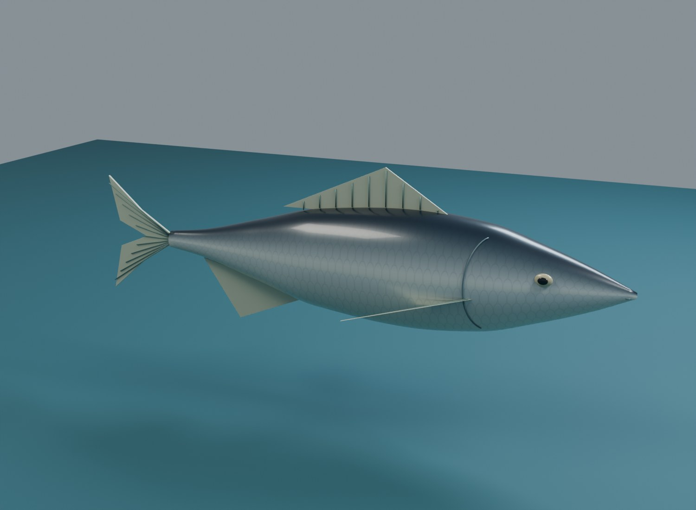
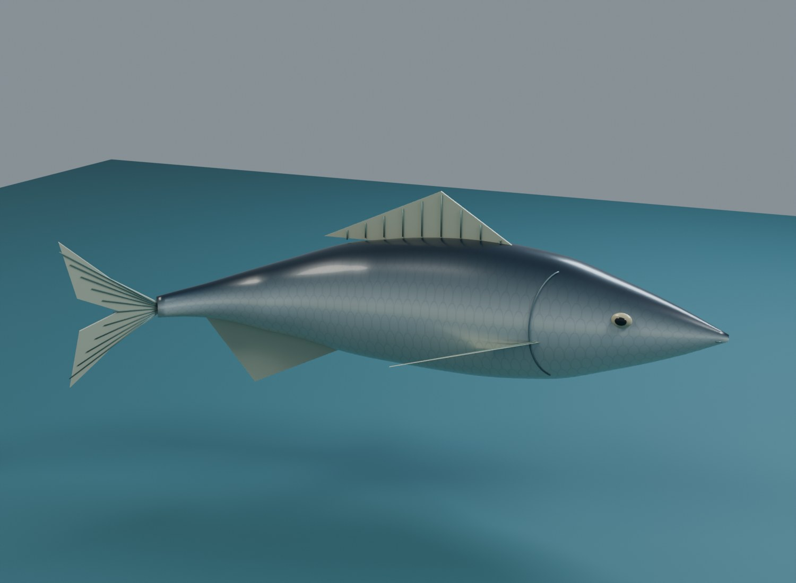

# A010 Agnfisk

Original, sølvfarget agnfisk med blågrønn rygg, lys buk, gyllen sidelinje, modellerte finner, øyne og gjellekonturer. En firebeins rigg gir en gjentakende svømmebevegelse med halen, mens hodets agnfeste holdes stabilt.

Opprettet 4. november 2026. **Til kontroll før agnfeste og bevegelse prøves i hovedspillet.**

Bildene tas fra den gjenåpnede 3D-kilden. Fisken er en generell agnfiskform, uten en fastsatt virkelig art. Den er omtrent 20 cm lang som visuelt arbeidsmål; dette er ingen opplysning om en fangst i spillet.

## Modell og rigg

Kilden bruker meter. +Y peker mot hodet, +Z mot ryggen og +X mot fiskens ene side. Origo ligger ved kroppens lengdemidtpunkt. Modellen har 10 320 trekanter, seks materialplasser og 39 redigerbare kildedeler.

Skjellfargene kommer fra et egenprodusert 2K-kart. Finner, finnestråler, øyne, munn og gjellekonturer er modellert som egne komponenter. Teksturen har ingen innbakte harde skygger eller solglimt.

`BodyRoot`, `Tail_01`, `Tail_02` og `Tail_03` deformerer kropp og hale. Handlingen `A010_BaitSwim_Loop` går fra bilde 1 til 61 ved 30 bilder per sekund. Hodet holdes i ro mens halen beveger seg til begge sider, slik at en eventuell krok kan holde et stabilt festepunkt. Den overordnede agnbevegelsen, driften og fiskedybden må komme fra spillets agnprogram.

`SOCKET_BaitHook` ligger ved snutepartiet, `SOCKET_Mouth` ved munnen og `SOCKET_Tail` følger halen. Ankerpunktet for agn brukes som utgangspunkt mot A009-kroken. Endelig plassering og orientering kontrolleres når agn og krok settes sammen.

## Leveranse

| Fil | Bruk |
| --- | --- |
| `FISKELAGET_A010_Agnfisk_v1.blend` | Redigerbar kilde, skjelettmodell, svømmeløkke og kamera. |
| `exports/SK_FISK_Baitfish_v1.fbx` og `.glb` | Modell, rigg, animasjon, materialer og ankerpunkter. |
| `textures/T_FISK_Baitfish_Scales_BaseColor_2K.png` | Pakket og separat lagret skjellfargekart. |
| `build_blender.py` | Gjenskaper modell og eksporter; bruker felles modellhjelpere fra A007. |
| `build_report.json`, `validation_report.json` | Mål, mengder, svømmekontroll og eksportresultater. |

Den riggede modellen vises som standard i Blender. Kildedelene ligger i en egen skjult samling. Ved Unreal-import brukes skjelettmodell og animasjon. Kontroller at det metalliske skinnpreget, finnedetaljene og øynene fungerer i undervannslys og i spillets morgenlys.

Se [QA.md](QA.md). Ingen eksterne fiskemodeller eller teksturer inngår.
