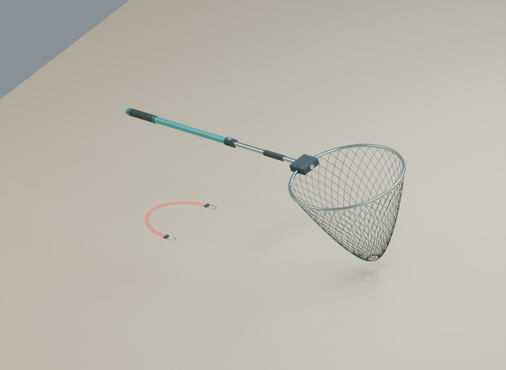

# A011 Håv og sikringstropp

Landingsutstyr til den første fisketesten: håv med ovalt metallhode, diamantformede nettåpninger, todelt skaft og mørke grep. En separat korallfarget sikringstropp har metallklips og egne festepunkter.

Opprettet 4. november 2026. **Til kontroll før landing, figur og båt prøves sammen i hovedspillet.**

Bildet viser de faktiske Blender-modellene. Stroppen er flyttet til siden i presentasjonen; de to utstyrsdelene har egne røtter og plasseres separat i spillet.

## Mål og innhold

| Del | Arbeidsmål |
| --- | --- |
| Håvens nominelle samlede lengde | Omtrent 2,22 meter. |
| Hode langs bøylens senterlinje | 64 × 72 cm. |
| Innvendig åpning | Omtrent 62 × 70 cm. |
| Nettpose | 55 cm dyp. |
| Nettsnor | Diameter 2,4 mm. |
| Sikringstropp | 25 mm bred, med to klips. |

Håvskaftet går fra −Y mot +Y, med bøylen i XY-planet og nettposen ned langs −Z. Origo ligger ved overgangen mellom skaft og håvhode. Samlingen har 108 redigerbare kildedeler og fem spillmodeller: ytre skaft, indre skaft, bøyle, nettpose og stropp.

Nettposen består av modellerte snorer med reelle åpninger mellom dem. De to skaftdelene og låsekragen gir et grunnlag for senere innskyving og oppbevaring. Delene leveres i én utstrakt hvileposisjon. Det følger ingen ferdig teleskop- eller landingsanimasjon med.

Sju ankerpunkter viser håndgrep, bøylens sentrum, støttepunkt for fangst, oppbevaring i båten og stroppens to ender. Ankerpunktene er arbeidsforslag for figur og fangst. En fysisk fisk, nettpose eller klips blir ikke automatisk bundet til dem av modellen alene.

## Leveranse

| Fil | Bruk |
| --- | --- |
| `FISKELAGET_A011_Landingsutstyr_v1.blend` | Redigerbar kilde med håv, stropp, fem spillmodeller og presentasjon. |
| `exports/FISK_LandingEquipment_v1.fbx` og `.glb` | Fem separate spillmodeller, to røtter og sju ankerpunkter. |
| `build_blender.py` | Gjenskaper geometrien; bruker felles hjelpere fra A007. |
| `build_report.json`, `validation_report.json` | Mål, mengder og eksportkontroll. |

`FISK_LandingNet_Root` flytter håven. `FISK_SecuringStrap_Root` flytter stroppen. Den ekstra stroppkopien i presentasjonen ligger utenfor eksporten. Ved import beholdes utstyrsdelene separate slik at de kan legges til hånd, båt og fangst ved riktig hendelse.

Stål, turkis skaft, mørkt nett, gummi og korallfarget stropp bruker egne PBR-materialer. Materialene har ingen eksterne teksturer. Kollisjon og tilpasning av nettposen mot fangsten må bygges og prøves i spillet; en stor konveks form rundt hele håven vil fylle nettåpningen og egner seg ikke som eneste løsning.

Utstyrets egnethet for fiskestørrelser og selve én-handlings-landingen avklares i spilltesten. Tyngre slepeutstyr følger A034. Se [QA.md](QA.md). Ingen eksterne modeller inngår.
