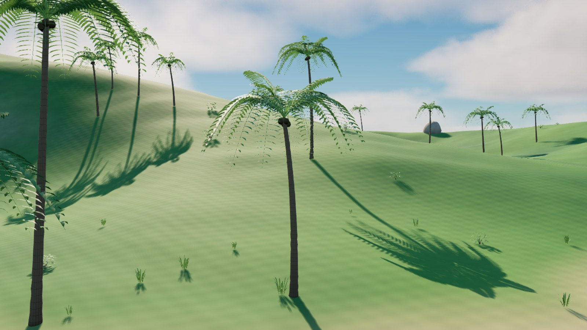

# A026 Tropisk vegetasjon

Første vegetasjonspakke for FISKELAGET med tre palmevarianter, en lav tropisk busk og en gresstue til strandkanten. Modellene er lagt inn i øyas [versjon 2](../A003_oy_og_kyst/README.md) og følger [assetstandarden](../../FISKELAGET_Assetstandard.md).

**Status: Til kontroll. Native ressurser og lagret øyscene er kontrollert etter gjenåpning av prosjektet.**

Opprettet og kontrollert 4. november 2026.

## Palmer

Palmevariantene har svakt buede, avsmalnende stammer med ringdetaljer, kokosnøtter og bladvifter i flere høyder. Kronene har både oppadrettede unge blader og lengre, hengende blader. Barken, bladene og kokosnøttene har egne materialer.

Bladene er modellert med fold og enkeltblad langs hver vifte. Det tosidige bladmaterialet har lysgjennomgang og en svak vindbevegelse. Vindstyrken kan justeres med parameteren `WindStrengthCm`.

| Modell | Høyde før skalering | Trekanter |
| --- | --- | --- |
| `SM_FISK_Palm_1_v1` | Omtrent 12,8 m | 10 060 |
| `SM_FISK_Palm_2_v1` | Omtrent 14,9 m | 11 140 |
| `SM_FISK_Palm_3_v1` | Omtrent 16,6 m | 12 284 |
| `SM_FISK_TropicalShrub_v1` | Omtrent 1,4 m | 870 |
| `SM_FISK_CoastalGrass_v1` | Omtrent 0,7 m | 160 |

## Bruk og arbeidsprosjekt

De native ressursene ligger under `/Game/Fiskelaget/Vegetation` i `../A003_oy_og_kyst/unreal/FiskelagetIslandAsset.uproject` (lokal prosjektfil). Prosjektet åpner den detaljerte øyscenen. Bruk **Migrate** på ønskede modeller med avhengigheter når pakken skal flyttes til hovedspillet.

Vegetasjonen er plassert som individuelle meshaktører i første utgave. Det gjør plassering, størrelse og rotasjon enkle å endre. Ved senere gruppering eller instansering må vindens rotpunkt og bøyeforløp kontrolleres på nytt.

Kollisjon er foreløpig slått av. Eventuell kollisjon for stammer må tilpasses spillerens og båtens behov ved integrasjon; bladkronene skal ikke brukes som store, lukkede kollisjonsvolumer.

## Kildefiler

- `vegetation_preset.json` styrer palett, vindstyrke, antall planter og friområdet ved marinaen.
- `generate_vegetation.py` lager redigerbare OBJ- og MTL-filer.
- `vegetation_surface.hlsl` inneholder overflatefarger, barkringer, bladvariasjon og vind.
- `build_vegetation.py` oppretter materialer og native Unreal-modeller.
- `validate_geometry.py` kontrollerer kildegeometrien. Åpne bladkanter er tilsiktet; stammer og kokosnøtter skal ha lukkede flater.
- `validate_vegetation.py` kontrollerer de importerte modellene og den samlede øyscenen.

Modellene og materialene er laget fra prosjektets egen kildekode. Ingen kjøpte modeller eller eksterne teksturer inngår.

## Kontrollstatus

Se [QA.md](QA.md), [geometry_validation.json](geometry_validation.json) og [validation_report.json](validation_report.json) for gjennomførte kontroller og gjenstående arbeid.
