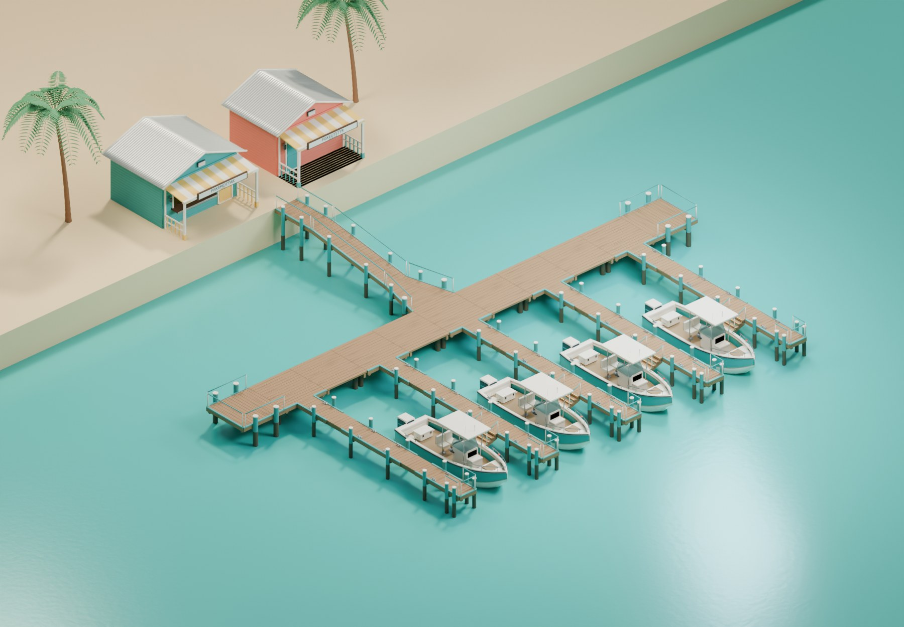

# A028 Modulær marina

Tolv gjenbrukbare bryggemoduler med tredekke, turkise stolper, lyse detaljer, fortøyning og faste koblingspunkter. Eksempelmarinaen har fire startbåter, smale utliggere, ombordstigningstrapper og landgang til butikk og fiskemottak.

Leveranse registrert 5. november 2026. **Til kontroll før integrasjon i hovedspillet.**

Se også [moduloversikt](A028_moduloversikt_v1.jpg) og [detalj av ombordstigning](A028_ombordstigning_v1.jpg).

## Moduler

Målene under er nominelle dekksmål i meter. Rekkverk, stolper og beslag kan stikke utenfor. N er +Y, E er +X, S er −Y og W er −X.

| Modellnøkkel | Dekksmål | Koblinger |
| --- | --- | --- |
| `Straight3x6` | 3 × 6 | N/S, bredde 3 m. |
| `Hub3x3` | 3 × 3 | N/E/S/W, bredde 3 m. |
| `Corner3x3` | 3 × 3 | S/E, bredde 3 m. |
| `Tee3x3` | 3 × 3 | S/E/W, bredde 3 m. |
| `End3x3` | 3 × 3 | S, bredde 3 m. |
| `Finger1p2x6` | 1,2 × 6 | N/S, bredde 1,2 m; sidefester for trapp E/W. |
| `FingerEnd1p2` | 1,2 × 1,2 | S, bredde 1,2 m. |
| `Branch3x3` | 3 × 3 | E/W/S, bredde 3 m; N, bredde 1,2 m. |
| `RampAdapter3to1p5` | 3 m lang | S, bredde 3 m; N, bredde 1,5 m. |
| `Gangway1p5x6` | 1,5 × 6 | S lav og N høy, bredde 1,5 m. |
| `TopLanding1p5x3` | 1,5 × 3 | N/S, bredde 1,5 m. |
| `BoardingSteps0p9x1p2` | 0,9 × 1,2 | Sidefeste W og eget overgangspunkt mot båten. |

Bryggedekket ligger 1,35 m over vannreferansen. Landgangen stiger 0,85 m over 6 m, omtrent 8,06 grader, til en reposhøyde på 2,20 m. Trappen går ned fra 1,35 til 0,95 m. Stolpene går ned til −2,40 m; endelig lengde må tilpasses havbunnen.

## Filer og redigering

- `FISKELAGET_A028_ModulaerMarina_v1.blend`: redigerbar kilde, tolv spillmodeller, kollisjon, koblinger og eksempeloppsett.
- `exports/SM_FISK_Dock_<modellnøkkel>_v1.fbx`: én modul med koblingspunkter og enkle UCX-kollisjonsformer.
- `exports/SM_FISK_Dock_<modellnøkkel>_v1.glb`: samme modul med materialer og koblingspunkter, uten UCX-former.
- `textures/`: tre delte 1K-kart for treverk, også pakket i Blender-filen.
- [build_report.json](build_report.json): mål, geometri, koblinger og eksempelplasseringer.
- [validation_report.json](validation_report.json): kontroll av kilde og alle 24 eksportfiler.

Blender åpner med eksempelet synlig. `01_A028_Editable_Modules` inneholder 838 redigerbare deler, `02_A028_Game_Export` de kanoniske spillmodellene, `03_A028_Collision` kollisjonsformene og `04_A028_Connectors` koblingene. Skjul `80_Marina_Example` og vis ønsket samling ved redigering. `81_Module_Catalog` inneholder en separat modulutstilling. `90_Preview_Only` er bakgrunn, lys og kameraer.

## Plassering og import

Kilden bruker meter, +Z opp og vannreferanse ved Z = 0. Hver eksportert modul har rot ved lokal origo. Flytt og roter hele roten når du setter sammen marinaen. Match koblingssentre med samme bredde og rolle, med motsatt utvendig retning. Koblingspunktets lokale +Y peker ut fra modulen. Sidefestet til trappen skal kobles til `Board_E` eller `Board_W`, ikke en vanlig gangkobling.

Treverket bruker basefarge, roughness og OpenGL-normalkart. Roughness leses som data uten sRGB. Kontroller normalretningen ved Unreal-import og bruk eventuell grønnkanalvending der importoppsettet krever det. Material- og kollisjonsimport må kontrolleres i hovedspillet.

Eksempelet har 33 moduler og 32 koblinger. Alle modulene har en sammenhengende koblingsvei til land. Fire A005-båter er plassert uten overlapp i den statiske oppstillingen. Trappens overgangspunkt ligger 25 cm fra båtens inngangsanker horisontalt og 23 cm høyere. Dette er ankeravstand; spillerens faktiske ombordstigning, båtrulling og fortøyning må prøves i spillet.

## Gjenbruk og integrasjon

Treverk og øvrige bryggematerialer kommer fra A004. Klamp og fender kommer fra A030. Eksempelet viser A005-båter, A029-bygg og A026-palmer; disse følger ikke med moduleksportene. Modellene og materialene er fra prosjektets egen kilde. Byggeskriptet bruker disse pakkene og modellhjelpere fra A007; den lagrede Blender-filen har pakkede teksturer.

Landhøyden følger marinaforslaget til A003. Eksempelets strand er en enkel presentasjonsflate; marinaen er ennå ikke plassert i øyscenen eller hovedspillet. Se [kontrollstatus og gjenstående arbeid](QA.md).
