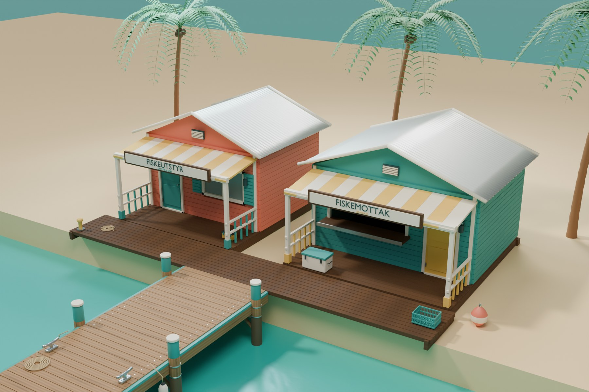
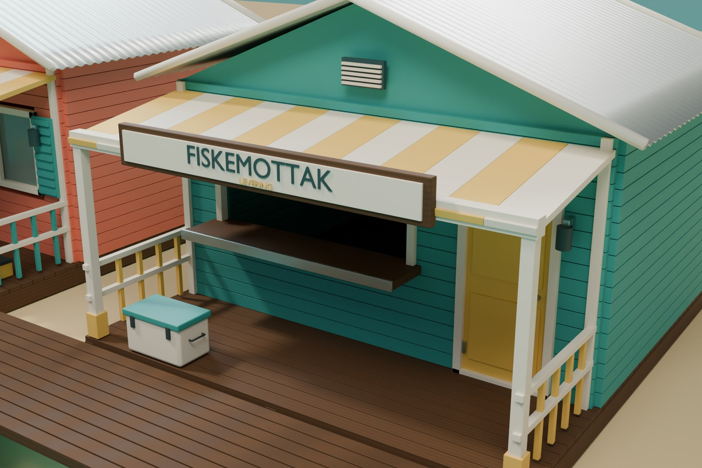
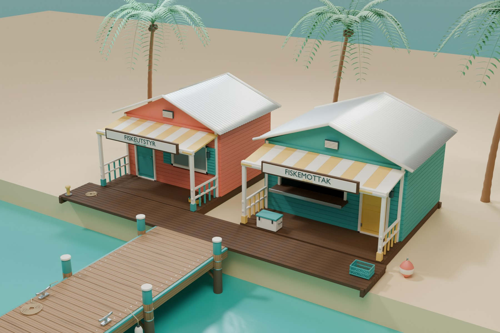

# A029 Butikk og fiskemottak

To originale fasadebygg til en kompakt karibisk marina: korallfarget utstyrsbutikk og turkist fiskemottak. Byggene har veranda, separate dører, kledningsbord, vindusrammer, skodder, korrugerte tak og modellerte skilt. Solgule detaljer, lyse stolper og treverk følger prosjektets [assetstandard](../../FISKELAGET_Assetstandard.md).

Opprettet 4. november 2026. **Blender-leveranse til kontroll før integrasjon i hovedspillet.**

## Bilder fra Blender

Bildene tas fra den gjenåpnede Blender-filen. A004-brygga, A026-palmer og A030-rekvisitter er egne prosjektressurser brukt i presentasjonen. Strand, sjø, boardwalk og lys er et visningsmiljø. Byggene er foreløpig ikke plassert på A003-øya eller i hovedspillet.

## Bygg og mål

| Egenskap | Utstyrsbutikk | Fiskemottak |
| --- | --- | --- |
| Rommets nominelle bredde | 4,8 meter | 5,4 meter |
| Rommets nominelle dybde | 3,8 meter | 4,2 meter |
| Verandadybde | 1,75 meter | 1,75 meter |
| Gulv over lokalt bakkenivå | 0,32 meter | 0,32 meter |
| Høyeste detalj | Omtrent 4,25 meter | Omtrent 4,25 meter |
| Nominelt dørfelt | 1,00 × 2,18 meter | 1,00 × 2,18 meter |
| Fri bredde mellom sideomrammingene | 0,91 meter | 0,91 meter |

Origo ligger på bakken ved midten av frontveggen. Fasaden vender mot −Y, +Y går bakover gjennom rommet og +Z peker opp. Kildene bruker meter. Takutspring, veranda, trinn og beslag gir større utstrekning enn selve rommet; se kontrollrapporten for modellens faktiske grenser.

Butikken har inngang, glassvindu og åpne skodder. Fiskemottaket har egen inngang, åpen betjeningsluke og disk med metallkant. Begge har veranda, sidegelender, små trinn og vegglamper. Pakken inneholder 421 redigerbare kildedeler og fem sammenføyde spillmodeller.

Skiltene viser `FISKEUTSTYR`, `UTSTYR & AGN`, `FISKEMOTTAK` og `LEVERING`. Det er ingen fangstvekt, pris, saldo eller resultattavle i geometrien. Skiltteksten er laget med Blenders innebygde skrift og konvertert til geometri.

## Leveranse og bruk

| Fil | Bruk |
| --- | --- |
| `FISKELAGET_A029_Marinabygg_v1.blend` | Redigerbar kilde med begge bygg, ferdige spillmodeller og egen marinapresentasjon. |
| `exports/TackleShop_v1.fbx` og `.glb` | Butikk, separat dør, rot og fire ankerpunkter. FBX inkluderer enkle kollisjonsformer. |
| `exports/FishReception_v1.fbx` og `.glb` | Fiskemottak, separat dør, åpen mottaksluke, rot og fire ankerpunkter. FBX inkluderer kollisjon. |
| `textures/` | Tre delte 2K-kart: trefarge, ruhet og OpenGL-normaler. |
| `build_blender.py` | Gjenskaper modeller og eksporter med prosjektets egne referanser. |
| `validate_marina.py` | Gjenåpner kildene, kontrollerer geometri og prøver eksportene i tomme scener. |
| `capture_marina.py` | Tar bilder fra de lagrede Blender-filene. |
| `build_report.json`, `validation_report.json` | Mål, modellnavn, ankre, kollisjon og kontrollresultater. |

Hvert bygg har egen rot: `FISK_TackleShop_Root` og `FISK_FishReception_Root`. Dørmodellene har egne hengselpunkter. Mottaksluken leveres i åpen posisjon med støttearmer i samme modell; eventuell lukkeanimasjon og ledddeling tilpasses senere.

Ankerpunkter viser inngang, handel eller levering, skilt og dørhengsel. Leveringspunktet står et stykke foran disken. De endelige spillerposisjonene og interaksjonsavstandene må prøves med figur og kamera.

Blender-filens redigerbare deler og kanoniske spillmodeller ligger i egne skjulte samlinger. Vanlig visning viser flyttede presentasjonskopier. Slå på ønsket kildesamling og skjul presentasjonen når delene skal redigeres. Hvert eksportert bygg har sin lokale rot ved origo og plasseres separat.

## Materialer og Unreal

Kledning og malt tre bruker delte ruhets- og normalkart. Synlig treverk bruker også et eget fargekart. Normaler og ruhet behandles som data uten sRGB; fargekartet bruker sRGB. Ved manuell normalimport kontrolleres behovet for **Flip Green Channel**, siden kildekartet bruker OpenGL-retning.

Behold separate dørdeler og dreiepunkter ved import. Det følger sju lukkede, konvekse FBX-kollisjonsbokser per bygg for gulv og hovedvegger. Døråpningene er bevart. Kollisjon for trinn, veranda, disk, gelender, dører og tak må vurderes sammen med figur og kameraføring. Kontroll av inngangsbredden bekrefter ikke ferdig navigasjon i spillet.

Handel, levering og serverens oppgjør kobles til egne spillfunksjoner. Dagens fangstresultater og betaling skal følge prosjektets regel om felles avsløring ved minutt 17.

Se [QA.md](QA.md). Bygg, materialkart og tekstgeometri er laget for prosjektet. Presentasjonen gjenbruker prosjektets egne assets.
