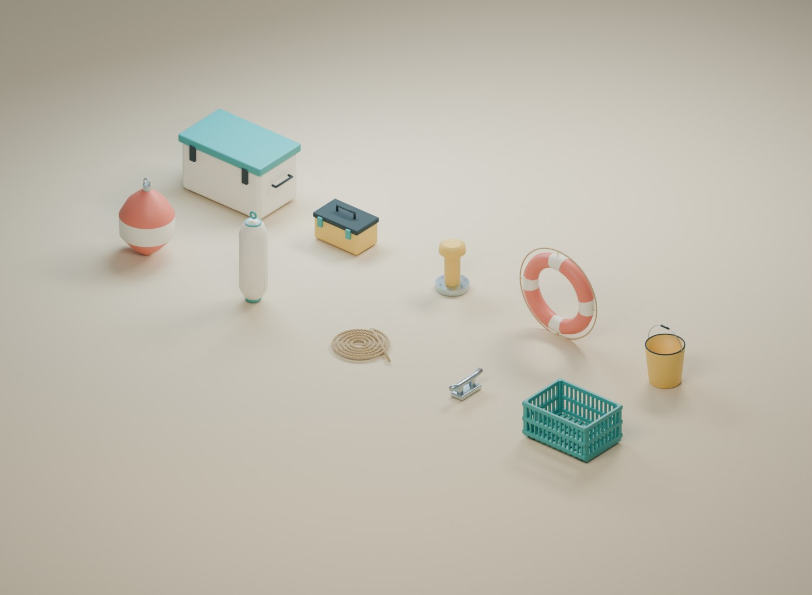

# A030 Marinadetaljer

Ti originale, gjenbrukbare rekvisitter til brygge, båt og marina. Fargene følger turkis, korall, solgult og elfenben fra prosjektets assetstandard. Modellene har virkelige mål, egne ankerpunkter og separate eksportfiler.

Opprettet 4. november 2026. **Til kontroll før plassering og testing i hovedspillet.**

Bildet er tatt fra den lagrede 3D-kilden. Utstillingsplasseringene og bakgrunnen inngår ikke i eksportene. Flere av modellene er også brukt i [A029-presentasjonen](../A029_butikk_og_mottak/README.md).

## Innhold

| Modellnøkkel | Ressurs |
| --- | --- |
| `Buoy` | Korallfarget bøye med lyst bånd og metalløye. |
| `Fender` | Lys fender med støpte ribber og turkise ender. |
| `RopeCoil` | Taukveil med tre modellerte, tvinnede kordeler og fri ende. |
| `Cleat` | Fortøyningsklamp med horn, sokler og innfestinger. |
| `FishCrate` | Tom spilekasse med åpninger, hjørneribber og stablingsføtter. |
| `Cooler` | Lukket kjøleboks med lokk, bærehåndtak, hengsler og låser. |
| `TackleBox` | Gul utstyrskoffert med grep og turkise låser. |
| `Bollard` | Gul fortøyningspullert med metallfot og seks innfestinger. |
| `Lifebuoy` | Redningsring med lyse felt, gripetau og taufester. |
| `Bucket` | Åpen bøtte med tykk vegg, bunn og metallhåndtak. |

Pakken har 144 redigerbare kildedeler og 56 544 trekanter fordelt på de ti spillmodellene. Mest geometri ligger i den tvinnede taukveilen og spilekassen. De er laget for nærvurdering; avstandsmodeller og eventuell instansering tilpasses senere.

## Filer og plassering

| Fil | Bruk |
| --- | --- |
| `FISKELAGET_A030_Marinadetaljer_v1.blend` | Alle redigerbare deler, ti kanoniske spillmodeller og en egen utstillingsscene. |
| `exports/SM_FISK_Marina_<modellnøkkel>_v1.fbx` | Én modell med tilhørende ankerpunkt. |
| `exports/SM_FISK_Marina_<modellnøkkel>_v1.glb` | Samme modell med PBR-materialer og ankerpunkt. |
| `build_blender.py` | Gjenskaper hele pakken med felles modellhjelpere fra A007. |
| `build_report.json` | Faktiske målgrenser, trekanttall og ankerposisjoner for hvert objekt. |
| `validation_report.json` | Resultater fra gjenåpning og tjue eksportprøver. |

Kilden bruker meter. Hvert objekt har lokal rot ved bunnen, med +Z opp. Modellene ligger ved origo i eksportfilene og plasseres enkeltvis. `SOCKET_<modellnøkkel>_Attach` er et utgangspunkt for fortøyning, grep eller feste. Tilpass endelig posisjon og retning til bruken i spillet.

Den vanlige Blender-visningen viser flyttede kopier av modellene. De redigerbare kildedelene og de kanoniske spillmodellene ligger i egne skjulte samlinger. Åpne riktig samling og skjul presentasjonen ved redigering.

Materialene beskriver malt plast/metall, gummi, stål og tau. Det brukes ingen eksterne teksturer. Den detaljerte tauoverflaten kommer fra modellerte kordeler. Lokk, låser og håndtak finnes som kildedeler; spillmodellene leveres i fast form uten ferdige åpne-/lukkeanimasjoner.

## Bruk i marinaen

Kassen er tom, og kjøleboksen er lukket. Modellene har ingen vekt-, pris- eller fangstvisning. Dersom spillfunksjoner senere viser innhold eller merking, skal dagens fangstopplysninger følge regelen om avsløring ved minutt 17.

Tilpass kollisjon, plassering og detaljnivå etter bruken. Åpne kasser og bøtter bør vurderes særskilt dersom andre objekter skal kunne plasseres inni dem. Bøye, fender og tau trenger egen kobling til vann, båt og fortøyning ved bevegelig bruk.

Se [QA.md](QA.md). Alle modeller er laget fra prosjektets egen kilde uten eksterne modellpakker.
